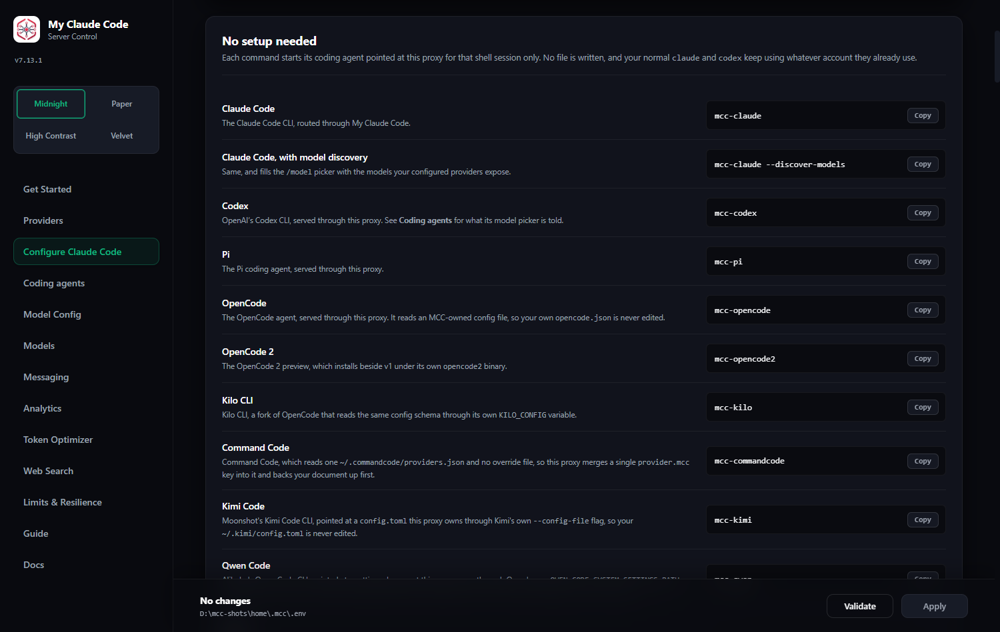
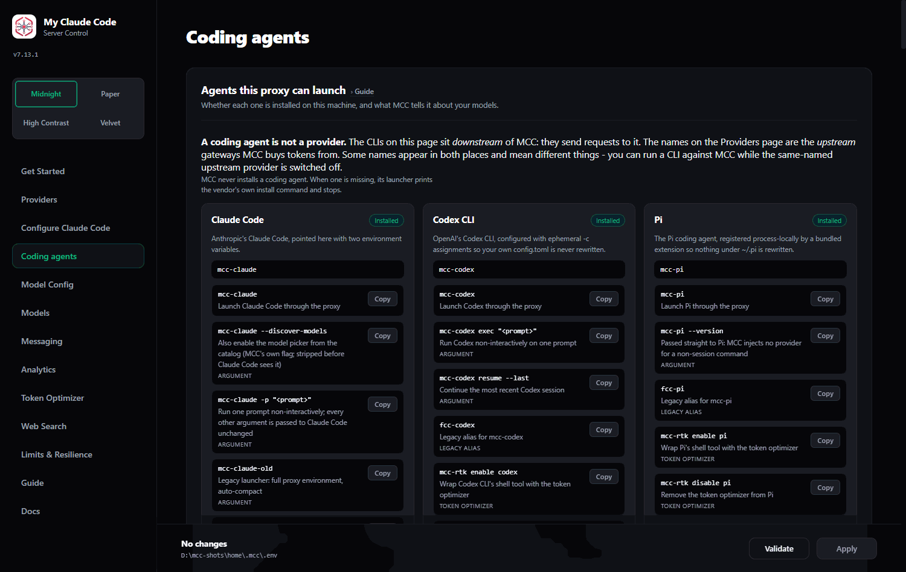
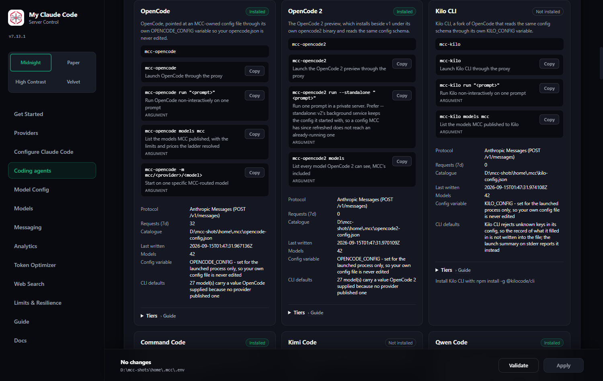
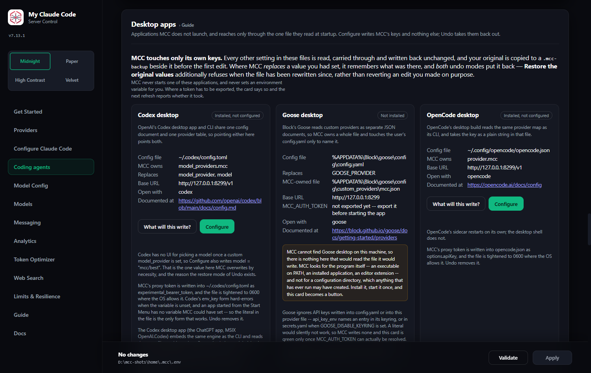

# Connecting other clients and editors

Editor integrations, and the [API reference](#api-reference) for any OpenAI-, Anthropic- or Gemini-shaped client: every endpoint MCC serves, how to authenticate, and one runnable example each.

For terminal use, start `mcc-server`, then run `mcc-claude`, `mcc-codex`, or `mcc-pi`. (The legacy `fcc-*` names were retired in 7.0.0: each prints the `mcc-*` name that replaced it and exits 1.) Use the guides below for editor integrations.

<div align="center">
  
  <p><em>Configure Claude Code → No setup needed: every launcher command, and what each one does to that shell session only.</em></p>
</div>

The **Coding agents** page is the same list with the detail behind it: whether the
CLI is installed on this machine, which protocol MCC answers it on, the catalogue
file MCC generates for it and when that file was last written. A card that is not
installed has an **Install** button that shows its plan before anything runs
([Install an agent from the dashboard](USAGE.md#install-an-agent-from-the-dashboard)).

<div align="center">
  
  <p><em>Coding agents: sixteen CLIs, each marked Installed or not, with its launcher commands.</em></p>
</div>

<div align="center">
  
  <p><em>One card in full: the protocol MCC answers on, the catalogue file it generates, and how many models that file carries.</em></p>
</div>

Applications MCC does not launch — the desktop apps — get a card each. It writes
only its own keys into the one file each app reads at startup, and copies the
original beside it first.

<div align="center">
  
  <p><em>Desktop apps: the file each application reads, the keys MCC replaces, and a dry run before anything is written.</em></p>
</div>

### Media tools for an agent: MCC's media server (MCP, 7.99.0)

Every agent card (and the Claude Desktop card) has an **Add MCP server** button. It gives
that agent MCC's media server, `mcc-mcp`: tools for the media rails you filled in on
Model Config -- `generate_image`, `edit_image`, `speak`, `transcribe`, `translate_audio`,
`create_video` / `get_video`, and the free `media_status` -- so the agent can make
pictures, speech, transcripts and video itself. **Remove MCP server** takes it out and
puts back exactly what was there. MCC writes it only into what it already owns (the
`mcc-claude` and `mcc-codex` launch lines, its config layers for OpenCode, OpenCode 2,
Kilo, Crush, Qwen Code and Gemini CLI, and its own Claude Desktop document), never into
your own files, and the token never goes into any of them: `mcc-mcp` reads it from MCC's
settings. Each agent asks before a tool that spends money; for OpenCode and Kilo MCC's
layer turns that ask on. The agent sends a few KB of tool text with each request while it
has the server -- the **MCC media server** card on the same page shows the figure, the
tools your rails give, and a line to add `mcc-mcp` to any other MCP app. Codex lists the
server but its model does not see the tools yet, and OpenCode 2's first `run` after its
service starts can begin before the server connects ([Known limits](MEDIA.md#known-limits-today)). Details:
[Coding agents: the media server](MEDIA.md#coding-agents-the-media-server-mcp-7990).

**In your own app files (7.100.0).** The **Desktop apps** cards for Codex desktop,
OpenCode desktop and Command Code have the same **Add MCP server** / **Remove MCP server**
button, for the app's own file: `~/.codex/config.toml` (`[mcp_servers.mcc_media]`),
`~/.config/opencode/opencode.json` (`mcp.mcc_media`, plus OpenCode's own `ask` for the
tools that spend money) and `~/.commandcode/mcp.json` (`mcpServers.mcc_media`) -- so the
apps started from their own icons, and plain `codex` and `opencode`, get the tools too.
The first press shows the change and a **Write it** button; the first write takes a
one-time backup beside the file; **Remove MCP server** or the card's **Undo** gives the
file back byte for byte. An `mcc_media` entry MCC did not add is left alone, and no token
is written. The Claude Desktop card has it as a **fallback** for
`claude_desktop_config.json` -- 60 seconds per tool call there -- for use only if MCC's own
document did not bring the tools after a relaunch. VS Code and Roo Code: not measured yet.
Details: [In your own app files](MEDIA.md#in-your-own-app-files-71000).

<details>
<summary><strong>Claude Code in VS Code</strong></summary>

Install the [Claude Code extension](https://marketplace.visualstudio.com/items?itemName=anthropic.claude-code). Open VS Code's user settings as JSON and add:

```json
"claudeCode.disableLoginPrompt": true,
"claudeCode.environmentVariables": [
  { "name": "ANTHROPIC_BASE_URL", "value": "http://localhost:8082" },
  { "name": "ANTHROPIC_AUTH_TOKEN", "value": "<your token: dashboard Providers -> Runtime>" },
  { "name": "CLAUDE_CODE_ENABLE_GATEWAY_MODEL_DISCOVERY", "value": "1" },
  { "name": "CLAUDE_CODE_AUTO_COMPACT_WINDOW", "value": "190000" },
  { "name": "DISABLE_AUTOUPDATER", "value": "1" },
  { "name": "DISABLE_FEEDBACK_COMMAND", "value": "1" },
  { "name": "DISABLE_ERROR_REPORTING", "value": "1" },
  { "name": "DISABLE_TELEMETRY", "value": "1" }
]
```

Match the port and authentication token to the Admin UI, then reload the extension.

</details>

<details>
<summary><strong>Codex App</strong></summary>

Start `mcc-server`, then edit your Codex configuration:

- Windows: `%USERPROFILE%\.codex\config.toml`
- macOS: `~/.codex/config.toml`

Add the matching model-catalog path and replace `YOUR_USERNAME`.

Windows:

```toml
model_catalog_json = "C:/Users/YOUR_USERNAME/.mcc/codex-model-catalog.json"
```

macOS:

```toml
model_catalog_json = "/Users/YOUR_USERNAME/.mcc/codex-model-catalog.json"
```

Then add the shared MCC settings:

```toml
model_provider = "fcc"
model = "nvidia_nim/nvidia/nemotron-3-super-120b-a12b"

[model_providers.fcc]
name = "My Claude Code"
base_url = "http://127.0.0.1:8082/v1"
env_key = "MCC_CODEX_API_KEY"
wire_api = "responses"
```

Match the model and port to the Admin UI. The `env_key` reads the same proxy auth token the `mcc-codex` launcher sets for each process. `mcc-server` publishes the catalog file under `~/.mcc/` on startup and whenever the model inventory changes, so restart the Codex App after setup or model changes, then select an MCC model from its model picker.

**Images in Codex (7.95.0).** An image you attach to a Codex turn (`codex -i shot.png`, or a paste) now reaches the model on your route: MCC's Responses door accepts it as the same image the Chat Completions door sends (before 7.95.0 it answered `400` and the turn failed). Images a Codex tool returns (`view_image`) still reach the model as text. Codex's own image-generation tool never calls MCC (measured with Codex 0.162.1). Its `imagegen` skill's command-line fallback can use your **Image rail** if you point it at MCC yourself -- `mcc-codex` does not set `OPENAI_*` for Codex, on purpose: run the skill with `OPENAI_BASE_URL=http://127.0.0.1:8082/v1` and `OPENAI_API_KEY` set to your proxy token ([Media routing → Codex](MEDIA.md#codex)).

</details>

<details>
<summary><strong>Codex in VS Code</strong></summary>

Install the [Codex extension](https://marketplace.visualstudio.com/items?itemName=openai.chatgpt). Create or edit `~/.codex/config.toml` (`%USERPROFILE%\.codex\config.toml` on Windows):

```toml
model_provider = "fcc"
model = "nvidia_nim/nvidia/nemotron-3-super-120b-a12b"

[model_providers.fcc]
name = "My Claude Code"
base_url = "http://127.0.0.1:8082/v1"
http_headers = { Authorization = "Bearer <your ANTHROPIC_AUTH_TOKEN>" }
wire_api = "responses"
```

Match `model`, the port, and bearer token to the Admin UI, then restart VS Code. For WSL-backed Codex, edit the file inside WSL.

</details>

<details>
<summary><strong>Claude Code in JetBrains ACP</strong></summary>

Edit the installed Claude ACP configuration:

- Windows: `C:\Users\%USERNAME%\AppData\Roaming\JetBrains\acp-agents\installed.json`
- Linux/macOS: `~/.jetbrains/acp.json`

Set the environment for `acp.registry.claude-acp`:

```json
"env": {
  "ANTHROPIC_BASE_URL": "http://localhost:8082",
  "ANTHROPIC_AUTH_TOKEN": "<your token: dashboard Providers -> Runtime>",
  "CLAUDE_CODE_ENABLE_GATEWAY_MODEL_DISCOVERY": "1",
  "CLAUDE_CODE_AUTO_COMPACT_WINDOW": "190000",
  "DISABLE_AUTOUPDATER": "1",
  "DISABLE_FEEDBACK_COMMAND": "1",
  "DISABLE_ERROR_REPORTING": "1",
  "DISABLE_TELEMETRY": "1"
}
```

Match the port and token to the Admin UI, then restart the IDE.

</details>

<details>
<summary><strong>Claude Code still asks you to log in</strong></summary>

If Claude Code asks you to log in after you configure the MCC URL and token, open its state file:

- Windows: `%USERPROFILE%\.claude.json`
- macOS/Linux/WSL: `~/.claude.json`

Merge this property into the existing JSON without removing its other fields:

```json
"hasCompletedOnboarding": true
```

If the file does not exist, create it with a complete JSON object:

```json
{
  "hasCompletedOnboarding": true
}
```

Restart Claude Code or the IDE after saving the file.

</details>

## API reference

MCC speaks four vendors' APIs on one port. Every example below was run against a
test install (its tiers pointed at a local stand-in provider) and answered as shown;
on your install the answer comes from the model your tier routes to.

### Base URL and authentication

| Client kind | Base URL to give it | Token header it sends (all accepted) |
| --- | --- | --- |
| Anthropic SDK, Claude Code | `http://127.0.0.1:8082` (the root; the SDK adds `/v1/messages`) | `x-api-key: <token>` or `Authorization: Bearer <token>` |
| OpenAI SDK and compatible clients | `http://127.0.0.1:8082/v1` | `Authorization: Bearer <token>` |
| Gemini SDK (`google-genai`), REST | `http://127.0.0.1:8082` (the SDK adds `/v1beta`) | `x-goog-api-key: <token>`, or `?key=<token>` |

The token is `ANTHROPIC_AUTH_TOKEN` (dashboard: Providers → Runtime). With it
empty, no token is asked for (see [Security](USAGE.md#15-security-and-networking)).
A wrong or missing token answers `401`: `{"detail": "Invalid proxy authentication token"}`
on the Anthropic and OpenAI chat doors, OpenAI's envelope
(`{"error": {"message": "Invalid proxy authentication token", "type": "authentication_error", ...}}`)
on the OpenAI media routes (`/v1/images/*`, `/v1/audio/*`, `/v1/videos*`, since 7.95.0), and
Google's error shape (`{"error": {"code": 401, "status": "UNAUTHENTICATED", ...}}`) on `/v1beta`.

An optional `x-mcc-harness: <name>` request header names the client in
**Analytics** (the `mcc-*` launchers set it); it is never sent upstream.

### Which model a request gets

| `model` you send | What answers |
| --- | --- |
| `mcc/cyber`, `mcc/best`, `mcc/good`, `mcc/medium`, `mcc/cheap` | the Mythos, Fable, Opus, Sonnet and Haiku tiers on **Model Config**, with their fallback chains |
| `mcc/vision` | the vision adapter's model |
| a Claude name (`claude-sonnet-4-5`, `claude-opus-…`) | the tier its family maps to |
| `provider/model` (`opencode/big-pickle`, `custom_x/y`) | that one model, which needs that provider's key |
| anything else | the default route (`MODEL`) |

`GET /v1/models` lists what your clients may pick. The media routes pick their
rail by endpoint; a `provider/model` sent there must be one of that rail's models
(7.95.0: one that is not is refused with `400`; any other name uses the rail --
[Media routing](MEDIA.md#how-a-request-finds-its-model)).

### Endpoints

| Method and path | Speaks | Example |
| --- | --- | --- |
| `POST /v1/messages` | Anthropic Messages, streamed or not | [below](#messages) |
| `POST /v1/messages/count_tokens` | Anthropic token count | [below](#count-tokens) |
| `POST /v1/chat/completions` | OpenAI Chat Completions, streamed or not | [below](#chat-completions) |
| `POST /v1/responses` | OpenAI Responses, **streamed only** | [below](#responses) |
| `GET /v1/models` | OpenAI/Anthropic model list | [below](#models-and-health) |
| `POST /v1beta/models/{model}:generateContent`, `:streamGenerateContent`, `:countTokens`; `GET /v1beta/models` | Google Gemini | [below](#gemini) |
| `POST /v1/images/generations`, `/v1/images/edits`, `/v1/audio/speech`, `/v1/audio/transcriptions`, `/v1/audio/translations`, `/v1/videos` (+ `GET`/`DELETE /v1/videos/{id}`, `GET /v1/videos/{id}/content`) | OpenAI media | [Media routing](MEDIA.md#every-rail-with-curl) |
| `GET /v1/media/models` | the media rails' models and the request fields each takes (7.98.0) | [below](#media-models-and-their-request-fields) |
| `GET /health` | liveness | [below](#models-and-health) |

#### Messages

```sh
curl http://127.0.0.1:8082/v1/messages \
  -H "x-api-key: $ANTHROPIC_AUTH_TOKEN" -H "anthropic-version: 2023-06-01" \
  -H "Content-Type: application/json" \
  -d '{"model": "mcc/medium", "max_tokens": 256, "messages": [{"role": "user", "content": "Say hello"}]}'
```

Answers an Anthropic `message` (`"stream": true` gives Anthropic's event stream).

**Tool changes in the middle of a conversation (7.102.2).** Claude Code 2.1.304
tells the model that its tools changed with a `role: "system"` message holding
`tool_addition` and `tool_removal` blocks; a resumed session always carries
them. MCC accepts both blocks on `/v1/messages` and `/v1/messages/count_tokens`
and turns them into the tool list before choosing a model, so every model gets
the same `tools` the conversation adds up to: an added tool is offered, a
removed one is not, and the blocks themselves are not sent on. A
`cache_control` breakpoint that sat on one of them moves to the block before
it. A request without these blocks is sent exactly as before. MCP references
(`mcp_tool_reference`, `mcp_toolset_reference`) name tools only Anthropic's own
MCP connector can reach, so they are dropped. A `tool_result` with no `content`
is accepted too, as Anthropic documents it.

#### Count tokens

```sh
curl http://127.0.0.1:8082/v1/messages/count_tokens \
  -H "x-api-key: $ANTHROPIC_AUTH_TOKEN" -H "anthropic-version: 2023-06-01" \
  -H "Content-Type: application/json" \
  -d '{"model": "mcc/medium", "messages": [{"role": "user", "content": "Say hello"}]}'
```

Answers `{"input_tokens": 6}`. MCC counts locally; nothing is sent to a provider.

#### Chat Completions

```sh
curl http://127.0.0.1:8082/v1/chat/completions \
  -H "Authorization: Bearer $ANTHROPIC_AUTH_TOKEN" -H "Content-Type: application/json" \
  -d '{"model": "mcc/medium", "stream": true, "messages": [{"role": "user", "content": "Say hello"}]}'
```

Server-sent `chat.completion.chunk` events ending in `data: [DONE]`; leave out
`stream` for one `chat.completion`. Reasoning streams as `delta.reasoning_content`.

#### Responses

```sh
curl -N http://127.0.0.1:8082/v1/responses \
  -H "Authorization: Bearer $ANTHROPIC_AUTH_TOKEN" -H "Content-Type: application/json" \
  -d '{"model": "mcc/medium", "input": "Say hello", "stream": true}'
```

`response.created` … `response.output_text.delta` … `response.completed`. A request
with `"stream": false` answers `400`: *MCC /v1/responses supports streaming only*.
An image in a user message (`{"type": "input_image", "image_url": "data:image/png;base64,…"}`
or an `https://` URL) is accepted since 7.95.0 and reaches the model as the same image the
Chat Completions door sends; an `input_image` with a `file_id` answers `400` (MCC has no
Files API).

#### Gemini

```sh
curl "http://127.0.0.1:8082/v1beta/models/claude-sonnet-4-5:generateContent" \
  -H "x-goog-api-key: $ANTHROPIC_AUTH_TOKEN" -H "Content-Type: application/json" \
  -d '{"contents": [{"role": "user", "parts": [{"text": "Say hello"}]}]}'
```

Answers `candidates[0].content.parts[].text` with `usageMetadata`; the path is the
model (here the Sonnet tier, by its Claude name; a tier alias works in the path
too, slash and all). `GET /v1beta/models` lists the same models in Google's shape. Asking for
`IMAGE` or `AUDIO` in `generationConfig.responseModalities` uses the media rails
([Media routing](MEDIA.md#gemini-shaped-requests-7650)).

#### Models and health

```sh
curl http://127.0.0.1:8082/v1/models -H "Authorization: Bearer $ANTHROPIC_AUTH_TOKEN"
curl -i http://127.0.0.1:8082/health
```

`/health` needs no token and answers `{"status": "healthy"}`, with an
`x-mcc-pid` header naming the server's process; while the server is starting
it answers `503` with `"status": "starting"`.

#### Media models and their request fields

```sh
curl http://127.0.0.1:8082/v1/media/models -H "Authorization: Bearer $ANTHROPIC_AUTH_TOKEN"
```

Since 7.98.0. One entry per model on a media rail (`"object": "media.model"`), with
its rails and, per operation it serves, the endpoint to send it to and a JSON Schema of
the request it takes; and per rail and operation, which of the rail's models accept,
require, refuse or say nothing about each field. Every field carries an `x-mcc` record
(`state`, `source`, `since`, `values`): a field nobody has spoken about is
`forwarded, not known`, never "unsupported". Run on a scratch server (fake Agnes, fake
key): `200`, 12,829 bytes, `data` = the Image rail's model and the two Video rail models;
the video rail's `fields.mode` answered
`{"accepted_by": ["custom_agnes/agnes-video-2.5"], "required_by": ["custom_agnes/agnes-video-2.5"], "refused_by": [], "not_forwarded_by": [], "not_known_for": ["custom_agnes/agnes-video-lite"]}`
after that model's host had refused a request with *mode is required*. Without a token it
answers `401` with `{"detail": ...}`, as `/v1/models` does. Read only: nothing a request
sends changes. Fields, states and sources:
[Request fields per model](MEDIA.md#request-fields-per-model-7980).

The images doors also take an opt-in request header, `x-mcc-inline-images: 1` (since
7.99.0; `mcc-mcp` sends it): every picture comes back as `b64_json`, and one the
provider answered with only a link is downloaded by MCC through that provider's own
client and proxy, so the caller never fetches a provider's address itself. Without the
header an answer is exactly what it was.

### Errors

A routing or provider failure answers in the door's own vendor shape (OpenAI
`{"error": {...}}`, Anthropic `{"type": "error", "error": {...}}`, Google
`{"error": {"code", "status", ...}}`). One answer does not: the `401` above on the
chat doors (the OpenAI media routes answer it in OpenAI's envelope since 7.95.0).
A body that does not parse as the door's request (a `messages` that is not a
list, say, or a content block type MCC does not know) answers `400` on
`/v1/messages`, `/v1/messages/count_tokens`, `/v1/chat/completions` and
`/v1/responses` since 7.102.3, in the door's own envelope with
`invalid_request_error`: the message names each failing field and the reason,
for example `messages.0.content.1: Input tag 'compaction' found using 'type'
does not match any of the expected tags: ...` (at most three fields, then
"and N more"; on the OpenAI doors `param` is the first field). It never repeats
any part of the request; before 7.102.3 it was a `422` whose `{"detail": [...]}`
list carried the input, which for a conversation was the whole conversation.
Each refusal also leaves a `REJECTED REQUEST` line in `server.log` (the first
per client per minute, then a summary) with the door, the field, the reason,
the client and the body's size, never its content. The dashboard routes keep
FastAPI's `422`.
A model whose provider has no key answers `503` naming the missing setting. A
request every model of its chain refused ends with
the last failure, its status and the sentence MCC wrote about it; the request
detail on **Analytics** shows every attempt. An empty media rail answers `404`
([why](MEDIA.md#every-rail-with-curl)).

<a id="optional-integrations"></a>

