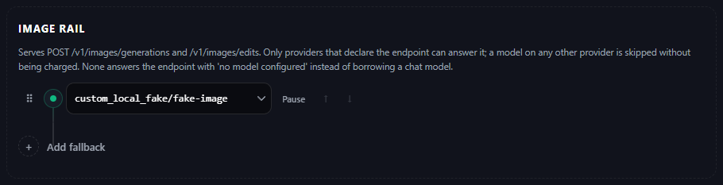
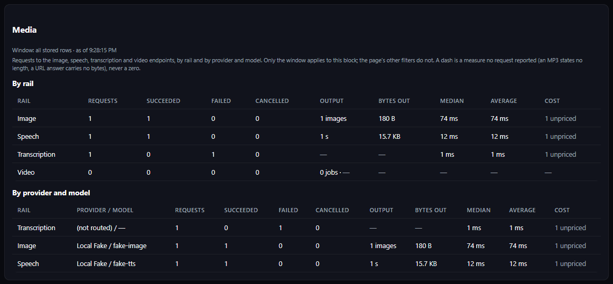

# Media routing

My Claude Code routes **media requests** -- image generation and editing, speech,
transcription and video -- over **media rails** on Model
Config, the way it routes chat over tiers. A client that speaks the OpenAI media API points
its base URL at the proxy and keeps its own code.

## What ships

| Endpoint | Since | Rail | Settings |
|---|---|---|---|
| `POST /v1/images/generations` | 7.60.0 | Image | `MODEL_IMAGE`, `MODEL_IMAGE_FALLBACKS`, `MODEL_IMAGE_PAUSED` |
| `POST /v1/images/edits` | 7.61.0 | Image | the same rail |
| `POST /v1/audio/speech` | 7.62.0 | Speech | `MODEL_TTS`, `MODEL_TTS_FALLBACKS`, `MODEL_TTS_PAUSED` |
| `POST /v1/audio/transcriptions`, `POST /v1/audio/translations` | 7.63.0 | Transcription | `MODEL_ASR`, `MODEL_ASR_FALLBACKS`, `MODEL_ASR_PAUSED` |
| `POST /v1/videos`, `GET /v1/videos/{id}`, `GET /v1/videos/{id}/content`, `GET /v1/videos`, `DELETE /v1/videos/{id}` | 7.64.0 | Video | `MODEL_VIDEO`, `MODEL_VIDEO_FALLBACKS`, `MODEL_VIDEO_PAUSED` |
| Gemini `:generateContent` / `:streamGenerateContent` with image or audio output, `:predictLongRunning`, `GET /v1beta/operations/{id}` | 7.65.0 | Image, Speech, Video | the same rails |
| `GET /v1/media/models`: every media rail model and the request fields it takes ([Request fields per model](#request-fields-per-model-798)) | 7.98.0 | every rail | none (read only) |

```python
from openai import OpenAI

client = OpenAI(base_url="http://127.0.0.1:8082/v1", api_key="your-proxy-token")
image = client.images.generate(model="gpt-image-2", prompt="a red cube on a white table")
edited = client.images.edit(
    model="gpt-image-2",
    image=[open("scene.png", "rb")],
    mask=open("mask.png", "rb"),
    prompt="make the cube blue",
)
```

The proxy token is the same one every other client uses (`Authorization: Bearer`,
`x-api-key` or `x-goog-api-key`).

## Tutorial: set up the Image rail and see the result

1. **Model Config → Image rail.** Pick the model that should answer image
   requests (the picker offers only image models, plus *Kind not known*), and
   **Add fallback** for the next one to try. Only a provider that declares an
   image endpoint can serve it (see the table below); a custom provider declares
   one with its **Media endpoints** checkboxes. Save.

<div align="center">
  
  <p><em>Model Config → Image rail: one model, with room for fallbacks. (Screenshot from a test install whose model is a local stand-in provider.)</em></p>
</div>

2. **Send a request** from any OpenAI-shaped client, or with curl (every rail's
   curl is in the next section):

   ```sh
   curl http://127.0.0.1:8082/v1/images/generations \
     -H "Authorization: Bearer $ANTHROPIC_AUTH_TOKEN" -H "Content-Type: application/json" \
     -d '{"prompt": "a red cube on a white table", "response_format": "b64_json"}'
   ```

3. **Analytics → Media** (near the bottom of the page) counts it per rail and
   per provider and model: requests, succeeded, failed, cancelled, images out,
   bytes, durations and cost. In the requests table the row is an ordinary one
   whose Endpoint is `/v1/images/generations`; filter by that endpoint (or
   Harness = *Script or curl*) to find it, and press **View** for its detail and,
   with **Store generated media** on, a preview.

<div align="center">
  
  <p><em>Analytics → Media: per rail, then per provider and model. The failed Transcription row is a request sent while that rail was empty (not routed).</em></p>
</div>

## Every rail with curl

`$ANTHROPIC_AUTH_TOKEN` is your proxy token (Providers → Runtime). Model names
that are not `provider/model` use the rail; a `provider/model` that is on the rail
pins that model, and one that is not is refused with `400` (7.95.0).
The image and speech requests and the empty-rail answer below were run against a
test install; the others follow the same OpenAI request shapes.

```sh
# Image: generate (Image rail)
curl http://127.0.0.1:8082/v1/images/generations -H "Authorization: Bearer $ANTHROPIC_AUTH_TOKEN" \
  -H "Content-Type: application/json" -d '{"prompt": "a red cube", "response_format": "b64_json"}'

# Image: edit, multipart (Image rail; served only by a provider that declares edits)
curl http://127.0.0.1:8082/v1/images/edits -H "Authorization: Bearer $ANTHROPIC_AUTH_TOKEN" \
  -F prompt="make the cube blue" -F image=@scene.png -F mask=@mask.png

# Speech (Speech rail): the answer is the audio file itself
curl http://127.0.0.1:8082/v1/audio/speech -H "Authorization: Bearer $ANTHROPIC_AUTH_TOKEN" \
  -H "Content-Type: application/json" -d '{"model": "tts", "input": "Hello there", "voice": "alloy", "response_format": "wav"}' -o hello.wav

# Transcription and translation (Transcription rail)
curl http://127.0.0.1:8082/v1/audio/transcriptions -H "Authorization: Bearer $ANTHROPIC_AUTH_TOKEN" \
  -F model=whisper-1 -F file=@clip.wav
curl http://127.0.0.1:8082/v1/audio/translations -H "Authorization: Bearer $ANTHROPIC_AUTH_TOKEN" \
  -F model=whisper-1 -F file=@clip.wav

# Video (Video rail): submit, poll, download
curl http://127.0.0.1:8082/v1/videos -H "Authorization: Bearer $ANTHROPIC_AUTH_TOKEN" \
  -H "Content-Type: application/json" -d '{"prompt": "a paper boat on a pond"}'
curl http://127.0.0.1:8082/v1/videos/video_abc123 -H "Authorization: Bearer $ANTHROPIC_AUTH_TOKEN"
curl http://127.0.0.1:8082/v1/videos/video_abc123/content -H "Authorization: Bearer $ANTHROPIC_AUTH_TOKEN" -o boat.mp4
```

**An empty rail answers `404`**, on purpose, with the OpenAI error shape:

```
{"error":{"message":"No model is configured for the Transcription rail. Set MODEL_ASR (and optionally MODEL_ASR_FALLBACKS) on Model Config; a media request is never sent to a chat model.","type":"not_found_error","param":null,"code":null}}
```

It stays a `404` rather than a `503` because the OpenAI SDKs retry a `503`
twice for nothing; the fix is a model on the rail, not a retry.

## How a request finds its model

- The **endpoint** picks the rail: `images/generations` and `images/edits` are the Image rail,
  `audio/speech` the Speech rail, `audio/transcriptions` and `audio/translations` the
  Transcription rail, `videos` the Video rail.
- A `model` written as `provider/model` (for example `xai/grok-2-image`) pins that one model --
  **only if it is on that request's rail** (7.95.0). A `provider/model` that is not on the rail
  is refused with `400` and nothing is sent, so spend stays where you configured it:

  ```
  {"error":{"message":"'together/flux' is not on the Image rail. Models on it: xai/grok-2-image, together/black-forest-labs/FLUX.1-schnell. Name one of them, or no provider/model at all to use the rail's chain; set the rail's models on Model Config (MODEL_IMAGE, MODEL_IMAGE_FALLBACKS).","type":"invalid_request_error","param":null,"code":null}}
  ```

  The refusal is logged (`error` / `invalid_request`) with no attempt and no cost. The same rule
  holds on the Gemini door (a `provider/model` in the URL) and for `:predictLongRunning`. Before
  7.95.0 any keyed provider's model could be named this way, on the rail or not.
- Any other `model` -- a vendor name such as `gpt-image-2`, or none -- uses the rail:
  `MODEL_IMAGE` first, then `MODEL_IMAGE_FALLBACKS` in order, skipping anything in
  `MODEL_IMAGE_PAUSED`.
- An empty rail answers `404` with an OpenAI error naming `MODEL_IMAGE`. A media request is
  never sent to a chat model.

A media rail is **not a chat tier**: `/v1/messages` cannot reach it, and a model saved on a
media rail (and on no chat rail) is not offered as a chat model.

### Which lists offer a model (7.78.2)

Every model has a **kind**: chat, or the media rail it belongs on (Image, Speech,
Transcription, Video). The kind comes from declared data only, never from a model's name, and
walks the same ladder as every other capability -- the provider's own model list first, then
the catalogues, each rung filling only what the one above left unsaid (7.80.0):

1. what the **provider's own model list** says the model accepts and produces (OpenRouter,
   Nous Portal, Kilo, Novita and Vercel publish this on every row) -- a model that reads and
   writes text is chat, one that writes an image is Image, writes audio is Speech, hears audio
   and writes text is Transcription, writes video is Video; a model can be several;
2. otherwise what **models.dev** catalogues it as accepting and producing (its `modalities`),
   down its own rungs: the provider's bucket, the OpenRouter reference, the cross-provider vote.
   **OpenRouter's own live model list** (7.84.0, `MODEL_METADATA_OPENROUTER_LIVE`) is a rung
   here too, matched by name: for a provider models.dev has no bucket for it answers before
   models.dev's OpenRouter reference and the vote; for one it describes, only where the bucket
   is silent -- it never overrides a bucket, and the Models page shows both where they differ.
   A pair with a word no kind rule reads (OpenRouter's `decisions`) states nothing.
   **LiteLLM's model map** (7.85.0) answers here too, only while LiteLLM pricing is on
   (`COST_SOURCE_LITELLM_ENABLED`): its `supported_modalities` / `supported_output_modalities`
   pair, where nothing above the cross-provider vote stated one, ahead of the vote -- the slot it
   holds for prices. A pair with a word no rule reads (LiteLLM's `code`) states nothing;
3. otherwise the **provider's model type or endpoint names** -- Novita's `model_type`, the
   endpoints Command Code or a new-api gateway says serve the model (`/chat/completions`,
   `/images/generations`, `openai-video`, ...). These are coarser than a modality list, so they
   only fill a gap; a word MCC does not know (Anthropic's `model`) says nothing. With LiteLLM
   pricing on, LiteLLM's `mode` and `supported_endpoints` follow the provider's own words;
4. otherwise, the media rail you saved it on, when it is on no chat rail.

A model whose kind is stated and is not chat is left out of `/v1/models`, `/v1beta/models`,
every coding agent's generated catalogue and every chat picker on Model Config. Each media rail's
picker offers only models of its own kind. A model **nobody has described** stays everywhere it
was: listed for chat, and selectable on every media rail under **Kind not known** -- unknown is
not unsupported. Nothing you saved changes: a model of another kind already on a rail stays
there, marked in its picker and on the Models page, and routes exactly as before. This is a
listing change only; no request is routed or sent differently.

The **Models** page shows a chip on every row whose kind is not chat, and one filter chip per
kind (plus *Kind not known*) with its count. Each model's capability panel has a **kind** row
naming the rung that stated it -- *the provider's model list*, *models.dev modalities*, *the
provider's model type or endpoints* or *your media rail* -- and how the id was matched.

## Which providers can serve it

A provider serves a media operation only when it **declares** that endpoint; MCC never guesses
from a model name. A model on a provider that declares nothing for the operation is skipped
and **not charged** a failure -- the request log shows it as `unsupported`.

| Provider | Generation | Edits (relative to the provider's base URL) |
|---|---|---|
| Gemini | `images/generations` on its OpenAI-compatible base URL | -- |
| xAI | `images/generations` | `images/edits` |
| Together | `images/generations` | -- |
| DeepInfra | `images/generations` on its OpenAI-compatible base URL | -- |
| Agnes AI | `images/generations` | -- |
| SiliconFlow | `images/generations` | -- |
| ZenMux | `images/generations` | -- |

An edit on the Image rail therefore skips every model whose provider declares no edit endpoint,
uncharged, and is served by the first one that does.

The body the client sent is forwarded field for field, with `model` replaced by the rail's
model id, so a parameter only one host understands still reaches it. What the host answers is
what the client receives -- `b64_json` or `url`, exactly as the host returned it.

**Edits** are forwarded in the client's own encoding. A multipart upload (`image`, `image[]`,
`mask` and the text fields) goes out as multipart, streamed from the server's spooled copy of
each file -- in memory below the multipart library's own threshold, on disk above it -- and
re-read from the start if the rail falls back to the next model; nothing is ever read whole on
the server's event loop. The JSON variant (`images: [{"image_url": ...}]`) goes out as JSON.

**Upload size: `MEDIA_UPLOAD_MAX_MB`** (7.95.0, default `0`, 0 to 10,000,000; Model Config →
*Media uploads*, under the four rails). `0` sets no limit of MCC's own and the provider's applies,
as before. Above `0`, a media request carrying a file larger than that many megabytes -- an image
to edit, audio to transcribe, a video's reference image, an inline image on the Gemini door -- is
refused with `413` before any provider is asked, so nothing is spent on it:

```
{"error":{"message":"The file uploaded as 'image' is 30.0 MB, over MEDIA_UPLOAD_MAX_MB (20 MB). Nothing was sent to a provider. Send a smaller file, or raise MEDIA_UPLOAD_MAX_MB on Model Config (0 = no limit).","type":"request_too_large","param":null,"code":null}}
```

The refusal is logged (`error` / `invalid_request`). Each file is measured on its own.

**Streaming** (`"stream": true`, partial images as server-sent events) is routed to a surface
documented to stream it when the rail has one. None of the providers above documents it yet, so
since 7.95.0 such a request is **served whole and answered as one event**: the request goes to
the rail as an ordinary one with `stream` and `partial_images` not forwarded (they are listed in
the row's `media.not_forwarded`), and the answer is a `text/event-stream` with one
`image_generation.completed` event per picture (`image_edit.completed` for an edit), carrying
the provider's `b64_json` (or `url`), `created_at`, the size/quality/format fields it sent and
its `usage`. There are no partial images, because there were none. Before 7.95.0 such a request
answered `400`. A rail where a model does declare streaming keeps routing the stream to it.

## Speech (text to speech)

`POST /v1/audio/speech` routes on the **Speech rail** (`MODEL_TTS`, `MODEL_TTS_FALLBACKS`,
`MODEL_TTS_PAUSED`) under the same rules as the Image rail. The answer is the audio itself,
returned with the provider's own `Content-Type`.

```python
audio = client.audio.speech.create(model="gpt-4o-mini-tts", voice="alloy", input="Hello there")
```

| Provider | Speech endpoint (relative to its base URL) | Formats it documents |
|---|---|---|
| Together | `audio/speech` | mp3, wav, raw |
| OpenRouter | `audio/speech` | mp3, pcm |
| Groq | `audio/speech` | not listed (the host judges) |
| SiliconFlow | `audio/speech` | not listed (the host judges) |
| ZenMux | `audio/speech` | not listed (the host judges) |
| Gemini | native `generateContent` (see below) | wav, pcm |

**Formats are never converted.** A client that names a `response_format` a provider does not
document skips that provider without charging it, and the rail moves on; a client that names
none gets the provider's own container. MCC ships no audio encoder.

`stream_format: "sse"` is routed to a surface that declares it when the rail has one. None
does yet, so since 7.95.0 the request is **served whole and answered as SSE**: `stream_format`
is not forwarded, and the answer is one `speech.audio.delta` event carrying the whole audio
(base64, exactly as the provider sent it) followed by `speech.audio.done` (with the provider's
token `usage` when it reported one). Before 7.95.0 it answered `400`. A plain request is
answered once the whole audio has arrived -- a failure before that falls back invisibly -- and
the OpenAI SDK's streaming helpers still work, they simply receive the complete file.

## Transcription and translation (speech to text)

`POST /v1/audio/transcriptions` and `POST /v1/audio/translations` route on the
**Transcription rail** (`MODEL_ASR`, `MODEL_ASR_FALLBACKS`, `MODEL_ASR_PAUSED`). The upload
(`file`, plus `language`, `prompt`, `response_format` and the rest) is forwarded as multipart,
streamed from the server's spooled copy and re-sent whole to each model tried. The answer --
JSON, text, SRT, VTT -- comes back exactly as the provider wrote it.

```python
text = client.audio.transcriptions.create(model="whisper-1", file=open("clip.wav", "rb"))
```

| Provider | Transcription | Translation |
|---|---|---|
| Groq | `audio/transcriptions` | `audio/translations` |
| DeepInfra | `audio/transcriptions` | `audio/translations` |
| Together | `audio/transcriptions` | -- |
| SiliconFlow | `audio/transcriptions` | -- |
| Mistral | `audio/transcriptions` (streams) | -- |
| OpenRouter | `audio/transcriptions` | -- |
| Gemini | native `generateContent` with a built-in instruction (see below) | -- |

A translation skips every model whose provider declares transcription only, uncharged.
`stream=true` is routed only to a surface that streams (Mistral); its `transcript.text.delta`
events are forwarded as they arrive.

## Video (a job: submit, then poll)

`POST /v1/videos` routes on the **Video rail** (`MODEL_VIDEO`, `MODEL_VIDEO_FALLBACKS`,
`MODEL_VIDEO_PAUSED`). A video is not one answer but a **job**: the provider accepts it, works
for seconds to minutes, and the client asks for its status until it is done.

```python
video = client.videos.create(model="veo-3.1-generate-preview", prompt="a paper boat on a pond")
video = client.videos.retrieve(video.id)  # ask again until status is "completed" or "failed"
client.videos.download_content(video.id).write_to_file("boat.mp4")
```

- **The rail is walked only until a provider accepts the job.** A refusal, an error or an
  answer without a job id moves to the next model under the usual rules. The first provider
  that answers with a job id wins, and the client gets MCC's own id for it (`video_...`).
- **After that the job never moves.** Every status check, the download and a delete go to the
  same provider, with the same key and through the same proxy address. A job the provider
  accepted and that later fails is reported as `failed` with the provider's reason; it is
  **never resubmitted** to the next model, so it is never billed twice. Submit again to start
  from the rail's primary.
- **Polling is yours.** Each `GET /v1/videos/{id}` makes exactly one status call upstream;
  MCC runs no background poller. Statuses are reported in OpenAI's four words (`queued`,
  `in_progress`, `completed`, `failed`) because the OpenAI SDK stops polling on any other word;
  a host's `processing` or `pending` is translated, and a word MCC does not know is passed
  through as the host wrote it.
- `GET /v1/videos/{id}/content` streams the video from the provider through the same key.
  After the provider has dropped it (Gemini documents two days for Veo), the answer is `404`
  with the code `video_expired` -- unless `MEDIA_STORE_ENABLED` kept a copy, which is then
  served from disk.
- `GET /v1/videos` lists the jobs submitted through MCC (not the provider's own list: jobs
  span providers and keys). `DELETE /v1/videos/{id}` forgets MCC's record; none of the
  providers below documents a delete, so the provider keeps the file until it expires.
- Jobs live in the request log, so with `REQUEST_LOG_ENABLED` off `POST /v1/videos` answers `503`
  before calling any provider (a job MCC could never read back would still be billed).
- If the key that created a job is removed from the configuration, the job answers `409`
  naming the provider: a job can only be read with the key that created it.
- A status check follows the chat rules for **key health**: a `401`/`403` or a `429` on that
  key is charged to it exactly as a chat request on that key would be. It is never rotated
  to another key, because the job belongs to this one.

| Provider | Submit | Status | Download |
|---|---|---|---|
| Gemini | `videos` on its OpenAI-compatible base URL (multipart, as the OpenAI SDK sends it) | `videos/{id}` | the `url` in the status answer |
| OpenRouter | `videos` (JSON: the SDK's form is re-encoded; `seconds` is sent as `duration`) | `videos/{id}` | `videos/{id}/content` |
| DeepInfra | `videos` on its OpenAI-compatible base URL (JSON, re-encoded) | `videos/{id}` | `videos/{id}/content?variant=` |
| A custom provider with its **Video** box ticked | `videos` | `videos/{id}` | the `url` in the status answer; when it carries none, `videos/{id}/content` (7.95.0) |

**A custom provider's video with no download URL (7.95.0).** A custom provider's Video box
declares OpenAI's `/videos` shape, and many such hosts serve the finished file only at
`videos/{id}/content`, never naming a URL. `GET /v1/videos/{id}/content` therefore asks for a
fresh status first, uses its URL if it has one -- exactly as before -- and otherwise downloads
from `videos/{id}/content` with the job's own key. A host that does not serve that path answers
the same `409` as before ("gave no address for the file yet"), never `video_expired`. Before
7.95.0 such a video answered `409` forever. The built-in providers keep their documented
addresses.

The body is otherwise forwarded field for field with `model` replaced by the rail's model, so a
host's own options (`aspect_ratio`, `resolution`, ... sent with the SDK's `extra_body`) reach
it. A provider that documents JSON only cannot take an uploaded `input_reference` file; such a
request skips it, uncharged. A download URL on another host than the provider's own is fetched
**without** the API key.

## Gemini-shaped requests (7.65.0)

A client that speaks Google's Gemini API (the `google-genai` SDK, or REST on `/v1beta`) reaches the
same rails:

| Request | Rail | Answer |
|---|---|---|
| `models/{model}:generateContent` or `:streamGenerateContent` with `generationConfig.responseModalities` containing `IMAGE` | Image | `candidates[0].content.parts[].inlineData` (base64 image) |
| the same with `AUDIO` | Speech | one `inlineData` part with the audio and the provider's own MIME type |
| `models/{model}:predictLongRunning` (the Veo shape) | Video | an operation `{"name": "operations/..."}` |
| `GET /v1beta/operations/{id}` | -- | Google's operation shape: `done`, then `response.generateVideoResponse.generatedSamples[0].video.uri`, or `error` |
| `GET /v1beta/files/{id}:download?alt=media` | -- | the video bytes (what `client.files.download(file=video)` fetches) |

```python
from google import genai
from google.genai import types

client = genai.Client(api_key="your-proxy-token",
                      http_options=types.HttpOptions(base_url="http://127.0.0.1:8082"))
image = client.models.generate_content(
    model="gemini-3.1-flash-image", contents="a red cube",
    config=types.GenerateContentConfig(response_modalities=["IMAGE"]))
operation = client.models.generate_videos(model="veo-3.1-generate-preview", prompt="a paper boat")
operation = client.operations.get(operation)  # ask again until operation.done
```

- A request **without** `IMAGE` or `AUDIO` in `responseModalities` is an ordinary chat request and
  takes the chat path exactly as before. Asking for both `IMAGE` and `AUDIO` answers `400`.
- The request is translated to the rail's OpenAI-shaped endpoints: the user's text parts become the
  `prompt` (or the text to speak), `candidateCount` becomes `n`, a voice named in `speechConfig`
  becomes `voice`, and inline images in the contents make it an **edit** with those images as the
  uploads. What has no exact equivalent there (`imageConfig`, `temperature`, ...) is **not
  forwarded** -- never guessed -- and is listed under `media.not_forwarded` in the request log row.
- Images are asked for as base64. A provider that answers with a URL only is downloaded through the
  same key (the key is sent only to the provider's own host) and inlined.
- `:streamGenerateContent` answers with one server-sent event carrying the whole answer, sent when
  the answer is complete.
- `:predictLongRunning` follows the video rules above: the rail is walked until a provider accepts
  the job; the operation is then pinned to it. `durationSeconds` becomes `seconds`; `aspectRatio`,
  `resolution`, `negativePrompt` and `seed` are sent under the OpenAI-compatible names Gemini's layer
  documents; a first-frame `image` is sent as `input_reference` (a provider that takes JSON only is
  skipped for it, uncharged). A failed job answers `done: true` with `error.code` 13 and the
  provider's message.
- Errors use Google's error envelope. `:predict` (the Imagen shape) is not served.
- **`MEDIA_FALLBACK_ON_UNDOWNLOADABLE`** (7.68.0, default off; Limits & Resilience). A provider
  that answers an image request with a URL has already generated -- and usually billed -- the
  image. Off: if MCC cannot download it, the client gets the error, as before. On: the download
  happens inside the attempt, so a download failure counts as that model's failure and the Image
  rail moves on to the next model (the first image may still be billed). It applies to
  Gemini-shaped image requests, the only answers MCC must download itself; OpenAI clients get
  the URL as the provider sent it, and an accepted video job is never resubmitted.

**Gemini on the Speech and Transcription rails (7.66.0).** Gemini's OpenAI-compatible layer has no
speech or transcription endpoint, so a Gemini model on these rails is called through Gemini's own
`models/{model}:generateContent` (with the API key in `x-goog-api-key`):

- **Speech:** the text is sent with `responseModalities: ["AUDIO"]`; `voice` is forwarded as the
  prebuilt voice only when it is one of the 30 voices Google's speech page lists (Zephyr ...
  Sulafat) -- any other voice, `instructions` and `speed` are not forwarded (Gemini's default voice
  speaks) and are listed in the row's `media.not_forwarded`. Gemini returns WAV or raw 24 kHz PCM.
  A client that named `wav` gets a WAV (raw PCM is given a WAV header -- framing, not transcoding);
  one that named `pcm` gets raw PCM; one that named nothing gets what Gemini sent, with its own
  content type. `mp3`, `opus`, `aac` and `flac` skip Gemini, uncharged.
- **Transcription:** the uploaded audio is sent inline (base64) with this instruction, verbatim:
  *"Transcribe the speech in this audio exactly as spoken. Answer with the transcript only, with no
  introduction or commentary."* -- plus *"The speech is in &lt;language&gt;."* when the client sent
  `language`. `prompt`, `temperature` and timestamps are not forwarded. The answer is `json`
  (`{"text": ..., "usage": {tokens}}`) or `text`; `srt`, `vtt` and `verbose_json` skip Gemini,
  uncharged. Translation is not declared for Gemini.
- An answer with no audio (or no text) counts as a failure of that model and the rail moves on.
  Token usage from Gemini's `usageMetadata` fills the row's tokens.

## Retry, fallback, keys, 429s and proxies

Every media rail follows the same rules as a chat chain, applied by a separate copy of the chat
engine that is held to it by a contract test (`tests/contracts/test_media_chat_parity.py`):

- `FALLBACK_SKIP_KINDS` decides which failures end the route (default: a malformed request).
  Anything else moves to the next model.
- `FALLBACK_RETRY_FIRST=retry_once` retries the primary once on a transient failure.
- Key rotation, lockouts and credits benching follow `{KEY}_ROTATION`, `CREDENTIAL_LOCKOUT_TIERS`
  and the rest of Limits & Resilience.
- With `RATE_LIMIT_ROUTES_AROUND_MODEL` on, a 429 benches the (key, model) pair and the rail
  moves on; the same diagnostic probe the chat engine uses -- a 16-token *chat* question to a
  chat model you configured on that provider, never an image -- decides whether the key or the
  model was limited.
- Proxy chains, `PROXY_MAX_LIVE_FAILURES`, trigger chips and the direct fallback apply to each
  key as they do for chat.
- The deadlines (`FALLBACK_FIRST_TOKEN_TIMEOUT`, `FALLBACK_TOTAL_TIMEOUT`, ...) apply with "the
  first token" meaning "the answer arrived". They ship at `0` (off).

**Media keeps its own health records.** A key locked out, a (key, model) pair benched or a
proxy address benched by a media request is benched for media only; the chat engine never
sees it, and the other way round. A non-streaming request is answered only once a model has
produced the whole answer, so a failure before that falls back without the client noticing.

## Request fields per model (7.98.0)

A media model's host can refuse a request for a field no catalogue mentions. On this
install's own log, 50 of 54 Agnes video creates came back
`400 {"code":"invalid_request","message":"mode is required ...","data":{"param":"mode"}}`
and six image requests `400 image_config is not supported by text image queue`. models.dev
lists no request field for any of its 369 media models, so nothing MCC read could have told a
client either thing.

Since 7.98.0 every model on a media rail publishes, per operation it serves, a **JSON Schema
(2020-12) of its request**, with an `x-mcc` record on every field saying what is known about
it and who said so:

| `x-mcc.state` | meaning |
|---|---|
| `stated` | a source says this model takes the field |
| `required (stated)` / `refused (stated)` | you said so on the Models page -- or, for required, MCC's own door will not take the request without it (`prompt`, `input`, `file`) |
| `required (learned)` / `refused (learned)` | this host said so in a refusal (below) |
| `not forwarded by MCC` | MCC does not send it to this host (a native Gemini body has no field for it; a stream flag to a host that documents no stream) |
| `forwarded, not known` | MCC sends it and nobody has said whether this model takes it. **Not known is never "unsupported".** |

`x-mcc.source` names the rung that answered, highest first -- the same provider-first,
gap-filling ladder every other model field is read from, never a model's name:

1. `operator` -- your own statement, typed on the Models page (`~/.mcc/media_request_fields.json`);
2. `learned` -- a refusal this host gave for this model and operation;
3. `provider_declared` / `mcc_adapter` -- the provider's declared endpoint (formats, voices,
   stream, renamed fields, JSON-only bodies) and what MCC's own adapter sends;
4. `provider_list` -- the provider's own `/models` row (`supported_parameters`; a name it leaves
   out stays *not known*);
5. OpenRouter's live list and LiteLLM's map -- declared and **inert**: the recorded copy of
   OpenRouter's list gives its media models only chat sampling names, and no LiteLLM entry MCC
   has recorded carries a media request field. Each is wired only after a measurement shows it
   does. models.dev is not a rung (measured empty).

Below them is the endpoint's own contract (`door`): every field of the OpenAI request type for
that operation, plus the fields the Gemini door maps a Veo body onto. `x-mcc.since` is the day a
source said it (none for declared data); `x-mcc.values` is the list a source gave, also the
field's `enum`; `x-mcc.also` lists what lower rungs said about the same field. A refused field
is `{"not": {}}` -- JSON Schema for "leave it out".

**Learned refusals.** When a host answers a media request with a 4xx that names a field --
OpenAI's `error.param`, a top-level `param`, Agnes' `data.param`, a validator's `detail[].loc`,
or a message that starts with the field (`image_config is not supported ...`) -- MCC writes it
down as `required (learned)` (a field the request did not carry) or `refused (learned)` (one it
did), per provider, model and operation, in `~/.mcc/learned_facts.json`. Only on hosts whose
body is the client's own fields (the OpenAI shapes); never `model`; never a 401, 403, 404, 429 or
5xx. It is kept for `STATED_FACT_TTL_SECONDS` (30 days) and then shown as stale and not used;
**Forget** on its row removes that one field's fact. Recording is all it does: **nothing MCC
sends changes** -- the request is routed, retried, charged, logged and answered exactly as
before, MCC skips no model and drops no field because of it (user decision 6 of 2026-10-16:
publish first).

**Where to read it.**

- **Models page -> Media models**: *Request fields* under each row -- the known fields with
  their state, source, values and date, the rest summarised as *forwarded, not known*, **Forget**
  on a learned row, **Remove** on yours, and a small editor to state a field yourself
  (operation, field, accepted / required / refused, optional values and type).
- **Models page -> a model's *Everything known***: a *media request fields* row for a model on a
  media rail, with what your statement, the host's refusals and the provider's list each said.
- **`GET /v1/media/models`** (same proxy token as every other route): every media rail model,
  its schema per operation and the endpoint to send it to, and, per rail and operation, which
  models accept, require, refuse, do not receive, or say nothing about each field -- every model,
  never only the primary and never only what they share.

```bash
curl http://127.0.0.1:8082/v1/media/models -H "Authorization: Bearer $ANTHROPIC_AUTH_TOKEN"
```

Run on a scratch server whose fake Agnes had answered the two refusals above (abridged):

```json
{"object": "list",
 "data": [{"id": "custom_agnes/agnes-video-2.5", "object": "media.model",
           "rails": [{"rail": "video", "position": "primary", "paused": false}],
           "operations": {"video_create": {"endpoint": "/v1/videos",
             "request_schema": {"$schema": "https://json-schema.org/draft/2020-12/schema",
               "type": "object", "required": ["prompt", "mode"],
               "properties": {"mode": {"x-mcc": {"state": "required (learned)", "source": "learned",
                 "since": "2026-10-18", "evidence": "mode is required (request id: ...)"}}, "...": {}}}}}},
          "..."],
 "rails": [{"rail": "video", "models": ["custom_agnes/agnes-video-2.5", "custom_agnes/agnes-video-lite"],
            "operations": {"video_create": {"endpoint": "/v1/videos",
              "fields": {"mode": {"accepted_by": ["custom_agnes/agnes-video-2.5"],
                                  "required_by": ["custom_agnes/agnes-video-2.5"], "refused_by": [],
                                  "not_forwarded_by": [],
                                  "not_known_for": ["custom_agnes/agnes-video-lite"]}}}}}]}
```

A media model still never appears in `/v1/models` or a coding agent's catalogue.

## Where to see it on the dashboard (7.67.0)

- **Models page -> Media models.** One row per model on a media rail: which rail(s), its place
  (primary or fallback N) and whether it is paused, the operations its provider declares, a warning
  when the provider declares nothing for that rail (such a model is skipped, uncharged), the output
  modalities models.dev lists for it (advisory; "unknown" when models.dev has no entry), whether the
  media engine has benched it (media's own records, never chat's) and whether its provider has a
  key. Under each row, *Request fields* (7.98.0) lists what its request takes and who said so
  ([above](#request-fields-per-model-798)). A second table lists every provider -- built-in or
  custom -- that declares media endpoints.
- **Analytics -> Media.** A card of its own for the selected time window, per rail and then per
  provider and model: requests, succeeded, failed, cancelled, images out, audio seconds in and out,
  video jobs and video seconds, bytes out and durations, plus the video jobs' current states. A total
  no row measured shows as a dash ("not measured"), never 0. Media rows are ordinary request-log rows,
  so the existing chat totals and charts on Analytics count them too, as they have since 7.60.0; the
  Media card is the media-only view.
- **Custom providers** can declare media endpoints: the **Media endpoints** checkboxes on the custom
  provider form (image generation, image edits, speech, transcription, translation, video). Each
  ticked operation is served at the OpenAI path relative to the provider's base URL
  (`images/generations`, `images/edits`, `audio/speech`, `audio/transcriptions`,
  `audio/translations`, `videos`). Nothing ticked means none, as before.

## What it costs (7.69.0)

A media request is priced the way a chat request is, from published sources only -- never a
price typed into MCC -- in the same order:

1. **The provider's own figure** when the answer reports one (OpenRouter's `usage.cost`).
2. **models.dev token prices**, when the host reported token usage (the gpt-image family, token-billed
   speech and transcription, Gemini's `usageMetadata`), including models.dev's audio-token prices
   (`input_audio`, `output_audio`) for the audio tokens a host reports.
3. **LiteLLM**, only if you turned it on (`COST_SOURCE_LITELLM_ENABLED`), in the unit it publishes for
   that operation: `output_cost_per_image` x images, `input_cost_per_character` x characters spoken
   (else `output_cost_per_second` x seconds of speech), `input_cost_per_second` x seconds of audio
   transcribed, `output_cost_per_second` x seconds of video, plus the audio-token prices.
4. Otherwise the row is **unpriced** -- shown as "unpriced", never as $0. models.dev publishes no
   per-image, per-second or per-character prices, so without a provider figure or LiteLLM most
   image, speech and video requests stay unpriced. A computed $0 is treated as unpriced; a $0
   the provider itself reported is kept.

A video is priced when a status check first sees the finished job with its length. The cost shows
in the request list and detail, in a **Cost** column of the Analytics **Media** card (priced amounts,
plus a count of unpriced requests -- they are never added as zero) and, when you tick them, in the
**Cost** and **Media** fields of an export. Media costs are part of the Analytics cost totals, like
their request counts. Requests logged before 7.69.0 are not priced retroactively.

## What is recorded

Every request writes an ordinary request-log row (its endpoint, e.g. `/v1/images/generations`)
with the chain's attempts, plus:

| Column | Meaning |
|---|---|
| `media_operation` | `image_generate`, `image_edit`, `speech`, `transcribe`, `translate` or `video_create` |
| `input_image_count` | images uploaded to an edit |
| `output_image_count` | items the host returned |
| `media_bytes_out` | decoded size of the base64 images (empty for a URL-only answer: not measured) |
| `media_sha_out` | SHA-256 of the first image, or of the audio |
| `input_audio_seconds` | audio a transcription heard: the provider's own figure, else a WAV upload's header; empty otherwise |
| `output_audio_seconds` | length of the audio, when its container states it (WAV); empty for MP3/Opus/AAC: not measured |
| `media_job_id` | the video job's MCC id (`video_...`) on the row of the request that submitted it |
| `output_video_seconds` | the video's length as the provider reports it, written once a status check sees the job completed; empty until then |

**The row's `protocol`** is the API the client spoke. Since 7.95.0 an OpenAI-door row says
which one: `openai_images` (generation and edits), `openai_speech`, `openai_transcriptions`
(transcription and translation) or `openai_videos`; a Gemini-door row says `gemini`. Rows written
before 7.95.0 keep the label they were written with -- every OpenAI-door media row then read
`openai_images` -- and are never rewritten. It is a label only: nothing filters or totals by it.

**A client that hung up (7.95.0).** A request answered whole (every media request that did not
stream) is logged `cancelled` -- not `success` -- when the client had already disconnected by the
time the answer was ready. What came back is kept exactly as for a success (the images and their
count, the stored files, a video's job, which a later status check still finds), and it is
**still priced**: the provider produced it and billed it. A streamed request keeps the rule it
has had since 7.78.4.

**In the requests table (7.95.0)** the Turn column says what a media row did, after any chip it
already had: `1 image generated` / `N images generated`, `speech · 4.2s` (or `speech` when the
container states no length), `transcribed · 31s` / `translated · 31s`, `video job` (with `· 8s`
once a status check has seen its length). A row that names an operation and produced nothing --
a refusal, an error -- says only what it was: `image request`, `speech request`,
`transcription request`, `translation request`, `video request`. Chat rows are drawn exactly as
before. The list (`GET /admin/api/requests`) carries the six columns this reads --
`media_operation`, `output_image_count`, `output_audio_seconds`, `input_audio_seconds`,
`output_video_seconds`, `media_job_id` -- empty on chat rows.

A video job's status checks and downloads do not add rows: the job itself (provider, model,
which key by position and fingerprint, which proxy address, status, progress, the provider's
error) is kept in the request log's `media_jobs` table and pruned with its submit row. The key
itself and the provider's download URLs are never stored.

A transcript is the row's output text (`output_text`, `output_chars`), like a chat answer.
Token usage, when the host reports it, fills the usual `tokens_in` / `tokens_out`. An edit's
uploaded files are always recorded by SHA-256, size and type (never their bytes); with
`MEDIA_STORE_ENABLED` on, each uploaded image also gets the request log's usual thumbnail
(`REQUEST_LOG_CAPTURE_IMAGES`, `REQUEST_LOG_IMAGE_MAX_PIXELS`).

### Keeping the images: `MEDIA_STORE_ENABLED`

Off by default. When on, each generated image, speech file and downloaded video, and each image
uploaded to an edit, is also written as a file named by its SHA-256 in the `media` folder beside
the request log (`~/.mcc/logs/media/`). Uploaded audio (a transcription's input) is not kept. The same image is stored
once. A file is deleted when the last request row that references it is pruned or the log is
cleared; turning the setting off stops new copies and leaves existing files alone. It lives on
**Analytics -> Request log**.

**`MEDIA_STORE_MAX_MB`** (7.68.0, default `0`, 0 to 10,000,000) caps the stored files. `0` keeps
every file until its request row is pruned. Above `0`, once the stored files together pass that
many megabytes, the oldest are deleted first; the request rows and their metadata (hash, type,
size) stay, and the row simply shows the file as no longer stored. The cap is applied whenever a
new media file is written, so lowering it takes effect with the next stored file.

**Previews.** The request detail (click a row on Analytics) has a **Media** section: every input
and output the request carried -- direction, type, size, a short hash -- and, only for files that
are stored, a preview (image, audio player or video player) loaded on demand from
`GET /admin/api/media/<sha256>`. That route answers only on the loopback address, serves image,
audio and video types as themselves (anything else, SVG included, as a download) and is never
used by list views.

## Error answers

Every failure of an OpenAI media route answers in OpenAI's error envelope, and since 7.95.0 so
does a refused proxy token (or any other refusal before the route runs) on `/v1/images/*`,
`/v1/audio/*` and `/v1/videos*`, which the OpenAI SDKs read:

```
{"error":{"message":"Invalid proxy authentication token","type":"authentication_error","param":null,"code":null}}
```

`401` is `authentication_error`, `403` `permission_error`, `404` `not_found_error`, anything else
`invalid_request_error`. Before 7.95.0 these answered FastAPI's `{"detail": ...}`. The chat routes
(`/v1/chat/completions`, `/v1/responses`, `/v1/messages`) keep `{"detail": ...}` unchanged; the
Gemini routes answer in Google's shape as before.

## Codex

- **Images you attach to a Codex turn** (`codex -i shot.png`, or a pasted image) work through MCC
  since 7.95.0. Codex sends them to the Responses door as `input_image` parts; MCC turns each into
  the same image block the Chat Completions door builds -- a base64 data URL or an `http(s)` URL --
  so the model on your chat route sees the picture, and the vision adapter, describe mode and
  image thumbnails treat it exactly as they treat a Chat Completions image. An `input_image` that
  names a `file_id` (OpenAI's Files API, which MCC does not have) is refused with a `400` saying
  so. Before 7.95.0 every attached image was refused with `400` and no request-log row.
- **Images a Codex tool returns** (`view_image`) are still sent to the model as text, as before;
  changing that changes requests that work today and is a separate decision.
- **Codex's own image-generation tool does not use MCC.** Measured with Codex 0.162.1 against a
  test install, with the provider `mcc-codex` writes, with `gpt-5.5`, and with the built-in OpenAI
  provider pointed at MCC: none of them ever sent the hosted image tool, or any image request, to
  MCC. With a ChatGPT sign-in it goes to chatgpt.com directly.
- **Codex's `imagegen` skill can use your Image rail by hand.** The skill's command-line fallback
  (`image_gen.py`) is an OpenAI SDK client: given `OPENAI_BASE_URL=http://127.0.0.1:8082/v1` and
  `OPENAI_API_KEY=<your proxy token>` it sends `POST /v1/images/generations`, which MCC routes on the
  Image rail. `mcc-codex` does **not** set these for you -- it keeps `OPENAI_*` out of Codex's
  environment on purpose -- so set them yourself in the shell you run the skill from:

  ```sh
  OPENAI_BASE_URL=http://127.0.0.1:8082/v1 OPENAI_API_KEY="$ANTHROPIC_AUTH_TOKEN" \
    python "$CODEX_HOME/skills/.system/imagegen/scripts/image_gen.py" generate --prompt "a red cube"
  ```

## Known limits today

What the current release does, stated so nobody has to find it by trial (checked
on 7.95.0; the last item on 7.98.0):

- **A deleted video job still counts** in the Media card's video jobs.
- **Gemini `candidateCount: 2`** comes back as one candidate holding two images.
- **A streamed image or speech request on a rail with no streaming provider** gets
  its whole answer as one event, never partial images or audio chunks: no provider
  MCC knows documents either stream.
- **Images returned by a Codex tool** (`view_image`) reach the model as text (above).
- **Codex's own image tool** never reaches MCC (above).
- **Request fields are published, not acted on.** Since 7.98.0 each media model's
  fields are published ([Request fields per model](#request-fields-per-model-798)),
  including what a host's refusal taught MCC (Agnes video's `mode`, image
  `image_config`). MCC still sends every request exactly as the client wrote it and
  passes a refusal back as the provider said it: it neither skips a model that would
  refuse nor drops a refused field (user decision 6, "publish first"). Whether
  Agnes' own model list carries any fields has not been measured; a `supported_parameters`
  list on any provider's row is read when present. OpenRouter's and LiteLLM's lists
  are not read for fields until a measurement shows they carry any.

## Not yet

Gemini's Interactions API (and the transcription model offered only there) is not used. Video on ZenMux, Agnes AI, xAI, Together, SiliconFlow, MiniMax and Alibaba
is not routed: each documents its own job API rather than the OpenAI shape, and each would be
its own small release. OpenAI's own video API (Sora) was shut down on 2026-09-24.
