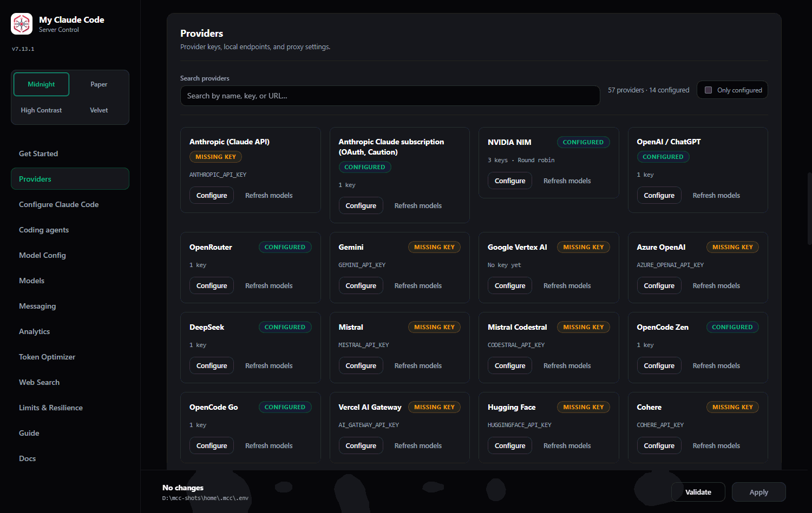
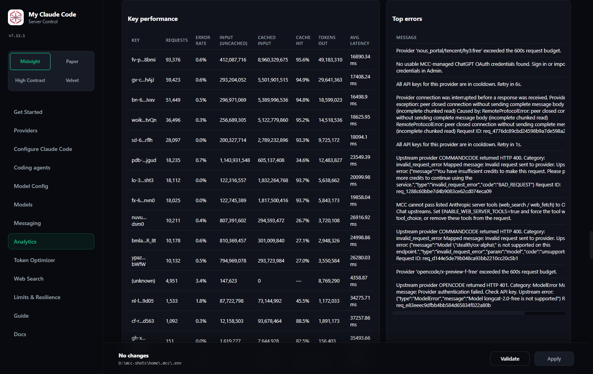

# OAuth providers

Sign-in-based providers: an Anthropic Claude subscription, ChatGPT, and Kimi For Coding. Moved out of the README in 6.57.0; nothing here changed.

An OAuth provider sits in the same grid as a key-based one and carries the same
badges — the difference is that its credential is a sign-in rather than a string
you paste.

<div align="center">
  
  <p><em>Providers: the two OAuth cards sit beside the key-based ones, each marked Configured or Missing key.</em></p>
</div>

Whichever credential a request ends up using, the request log records which key
answered and what it cost — a per-key table that works the same for an OAuth
credential as for a key in a rotation pool.

<div align="center">
  
  <p><em>Key performance, on Analytics: one row per credential, and the errors each one actually returned.</em></p>
</div>

### Anthropic Claude subscription (OAuth, Caution) — not permitted by Anthropic

> **Read [docs/ANTHROPIC-SUBSCRIPTION.md](./ANTHROPIC-SUBSCRIPTION.md) before enabling this.** It is the disclaimer, and this section is only the summary.

MCC can route requests with the OAuth credential from a Claude Pro or Max subscription, discovered from Claude Code's own `~/.claude/.credentials.json` or obtained with `mcc-anthropic-oauth-login`.

**Several accounts, since 7.30.0.** Signing in while an account is already stored **adds** another rather than replacing it; signing the same account in again updates it in place. Each account is a slot in the ordinary credential pool, so `ANTHROPIC_OAUTH_ACCESS_TOKEN_ROTATION` and the health ladder apply per account. Each carries a name, defaulted to the account's email address (which the token response already sends — MCC still never fetches the profile) and editable on the card, shown everywhere a key name is shown. The dashboard card is one row per account with its own **Refresh now** and **Disconnect**; `--list` and `--remove <id>` do the same from the command line. A credential read from Claude Code's file — imported or found automatically — is **shared** (7.69.1): Claude Code's file is the truth, MCC never renews it early and renews it only once it has expired and a real request needs it, under Claude Code's own `.oauth_refresh.lock`, writing the new token back by compare-and-swap before letting go. `ANTHROPIC_OAUTH_WRITE_BACK=false` makes it read-only. An account MCC signed in itself is **native** and renews as before, single-flight across MCC servers. See [ANTHROPIC-SUBSCRIPTION.md](./ANTHROPIC-SUBSCRIPTION.md#shared-and-native-credentials). **Downgrading to 7.29.x reads only the first account, and the first write an older build performs drops the rest**; a `.bak-<epoch>` copy is taken at migration and is the recovery path.

**Anthropic's published terms forbid it.** From [Claude Code → Legal and compliance](https://code.claude.com/docs/en/legal-and-compliance):

> Anthropic does not permit third-party developers to offer Claude.ai login or to route requests through Free, Pro, or Max plan credentials on behalf of their users.

There is **no "inside Claude Code" exemption**. Once MCC is interposed, Claude Code authenticates to *MCC*, and *MCC* makes the upstream call with your plan credential — which is exactly the sentence above, whatever launched the session. Anthropic states it may enforce without prior notice, and enforcement is account-level. **The risk is to your Claude account.**

**What MCC does to limit it.** Claude Code stamps an attribution line at the head of the system prompt, inside the request body:

```
x-anthropic-billing-header: cc_version=2.1.258; cc_entrypoint=cli;
```

**The subscription credential may serve requests from Anthropic's own clients only — the Claude Code CLI, the Claude Agent SDK and, since 7.92.1, the Claude desktop app.** Those are the entrypoints `cli`, `cli-bg`, `sdk-cli`, `sdk-py`, `sdk-ts`, `claude-desktop-3p` and `claude-desktop`; every other harness routed through MCC — OpenCode, Cline, Crush, a bare API call — is refused and pointed at the `anthropic` provider instead. Because the marker travels in the body, a proxy can neither forge it for traffic it did not receive nor strip it from traffic it did; it is still a good-faith attribution field rather than an authenticator, since its value is `CLAUDE_CODE_ENTRYPOINT`. Set `ANTHROPIC_OAUTH_REQUIRE_CLAUDE_CODE=false` to remove that protection — also settable as **Only Serve Claude Code And The Agent SDK** on the Claude subscription card of the **Providers** page (applies on Save, no restart). Until 6.36.0 the gate admitted `cli` alone and refused the Agent SDK, which Anthropic's policy names alongside Claude Code.

Since 6.36.0 the upstream request is Claude Code's own shape: the token goes in `Authorization: Bearer` (never `x-api-key`), `anthropic-beta` is MCC's floor unioned with the client's own list, and `user-agent`, `x-app` and `anthropic-version` are mirrored from the inbound request. Tool names go out verbatim. Before 6.36.0 this provider had never produced a successful request.

MCC's own credential lives at `~/.mcc/anthropic_oauth.json` (mode `0600`). Claude Code's file is read-only to MCC and is never refreshed in place — rotating it would log out your real client. The access token is refreshed ahead of expiry in the background, single-flight per credential file, and a 401 refreshes once and retries once. A raw `ANTHROPIC_OAUTH_ACCESS_TOKEN` works as a single-value override but cannot be refreshed, and a comma-separated list of them is rejected.

The Claude subscription card on the **Providers** page reports the plan, the rate-limit tier, both token expiries, the scopes, and the 5-hour/weekly usage windows — the last of these only when a real Anthropic response carried the header, and otherwise the literal *not yet observed*.

**Signing in, and the two buttons beside it (6.43.0).** *Sign in with Anthropic*
opens a loopback callback when one can work, and falls back on its own to a paste
prompt under WSL, over SSH, and anywhere else localhost is not shared — you can
paste **either the code Anthropic shows you or the whole callback URL out of the
address bar**; both are parsed. `mcc-anthropic-oauth-login` does the same from a
terminal, takes `--paste` and `--no-browser`, answers `--help` without starting
anything, and reports every failure as one line on stderr rather than a traceback.
The card also has **Refresh now** and **Disconnect**, both enabled only once MCC
has a credential of its own. **An import, a sign-in and a Disconnect all take
effect on the next request — no restart.** MCC watches the store's mtime and size
and re-resolves when either moves. (The one thing on this card that *does* need a
restart is `ANTHROPIC_OAUTH_REQUIRE_CLAUDE_CODE`, which is read when the provider
is constructed.)

**A dead store no longer masks a working credential (6.43.0).** MCC can see two
credentials — its own and Claude Code's — and picks between them **on viability,
not on existence**: if MCC's own access token is expired and its refresh token is
past its stated expiry, it falls through to `~/.claude/.credentials.json` and says
so once in `server.log`, naming both the source it chose and the one it skipped.
Before 6.43.0 the first file holding a non-empty token won even if that token was
years dead, and a stale store masked a healthy Claude Code login permanently.
*On macOS, Claude Code usually keeps its credential in the login keychain instead
of that file, which MCC cannot read — sign in rather than import there.*

**A rate-limited refresh is not a dead credential.** Only `400`, `401` and `403`
*with an OAuth error body* are treated as definitive. A `429` or a `5xx` or a
dropped connection is a transient failure: the stored credential is kept, the
provider reports it as an ordinary rate limit or overload exactly as it would for
any other provider, and **you are not told to sign in again** — signing in again
there would rotate a working credential away for nothing. When a refresh *is*
definitive, the store is **renamed aside to `anthropic_oauth.json.dead-<epoch>`,
never deleted**, so the evidence survives; Claude Code's own file is never touched
either way. *Disconnect* does the same rename.

**What "Caution" on the provider label means.** Not "experimental" — the code
works. It is three standing restrictions: Anthropic's terms forbid this and
enforcement is account-level (above); the credential serves **only** the
`cli`, `cli-bg`, `sdk-cli`, `sdk-py`, `sdk-ts`, `claude-desktop-3p` and `claude-desktop` entrypoints, so every other
harness routed through MCC is refused; and it is **one credential, never a
rotation pool** — a comma-separated `ANTHROPIC_OAUTH_ACCESS_TOKEN` is rejected at
construction, because rotating subscription credentials is the "unusual traffic
pattern" Anthropic's own policy names.

**The supported alternative is already here:** the `anthropic` provider with a [Claude Console API key](https://platform.claude.com/settings/keys), billed per token. Claude models also arrive through `bedrock`, `vertex`, and several gateways. And the two-door pattern still works — native `claude` for your subscription, `mcc-claude` for everything else.

### ChatGPT OAuth Provider (experimental)

MCC can talk directly to `chatgpt.com/backend-api/codex/responses` (OpenAI Responses API) using your ChatGPT subscription's OAuth tokens.

**Several accounts, since 7.30.0**, on the same terms as the Anthropic side: signing in adds, the same account updates in place, each account is its own pool slot under `CHATGPT_OAUTH_ACCESS_TOKEN_ROTATION`, and the card now has the per-account **Refresh now** and **Disconnect** it never had. A name defaults to the `email` claim of the id_token already on disk — read for that and nothing else; `sub` is still never read. An account imported from Codex is **shared** (7.69.1): Codex's `auth.json` is the truth, MCC re-reads it whenever it changes, never renews it early, and renews it only once it has expired and a real request needs it. Codex publishes no lock on that file, so the guarantee is weaker than on the Claude side and stated plainly: MCC re-reads the file immediately before the refresh and again immediately before the write, and writes (atomic rename, `account_id` and every other key untouched) only if the file still holds the refresh token MCC sent for the same account — otherwise it adopts Codex's token. If Codex starts its own refresh inside that window (about one round trip), one of the two refreshes fails and that client must sign in again. `CHATGPT_OAUTH_WRITE_BACK=false` makes a shared Codex account read-only. Importing from Codex no longer refreshes anything; an account MCC signed in itself stays native. `CHATGPT_OAUTH_ACCOUNT_ID` is **deprecated**: with several accounts it pins the `ChatGPT-Account-ID` header of the first account only, and every other account sends its own.

Four login paths:

1. **Admin UI → Log in with device code** — the default and recommended path; it works across Windows/WSL, SSH, containers, and other remote environments without a localhost callback.
2. **Admin UI → Browser login (same device)** — browser PKCE for cases where the browser and MCC definitely share the same localhost. Do not use it when MCC runs in WSL and the browser runs on Windows.
3. `mcc-chatgpt-oauth-login` — browser PKCE locally, with immediate device-code fallback under WSL/remote sessions or when the callback cannot start. `--device` forces device login; `--browser` explicitly confirms a same-localhost browser.
4. **Import Codex CLI Tokens** — after `codex login`, copy the complete renewable credential bundle into MCC without modifying `~/.codex/auth.json`.

MCC stores its renewable credentials separately at `~/.mcc/auth/chatgpt-oauth.json`. The Admin API and `.env` contain only a non-secret managed-credential reference. A raw `CHATGPT_OAUTH_ACCESS_TOKEN` remains supported as an advanced override, but it cannot be refreshed.

**The model list is discovered, not hardcoded.** The Codex backend publishes no model list for an OAuth session, and the Codex CLI does not call one either: it carries its own catalogue inside its executable. So MCC reads the model list from three places, strongest first, and the **Models** page labels each row with the one that put it there:

1. **The Codex CLI installed on this machine** — its own bundled catalogue, read off disk (never run), filtered by your plan when the stored sign-in names one. A model Codex marks hidden, or whose retirement date has passed, is not listed (it stays routable if a route names it). Updating Codex is what brings a new model in.
2. **Models this sign-in has already been served** — from the request log, unioned with the list above. A success logged *after* a model's retirement date keeps it listed; one logged before does not.
3. **A seed list**, only when neither of those answers anything (no Codex installed and no request logged yet): `gpt-6-astra`, `gpt-6.1-sol`, `gpt-5.6-sol`, `gpt-5.6-terra`, `gpt-5.6-luna` and `gpt-5.5` — what Codex 0.155.1 lists, plus `gpt-6.1-sol` (added 2026-10-07, which that Codex does not list). These rows are labelled *seed* because nothing on the machine confirmed them.

models.dev's `openai` catalogue is **not** used to decide which models exist (it describes OpenAI's paid API, with dozens of ids this sign-in has never served); it still supplies each model's capabilities and limits. A model the backend refuses by name is withheld from listings for 72 hours by default (`WITHHELD_FACT_TTL_SECONDS`) and stays routable. Optional overrides: `CHATGPT_OAUTH_ACCOUNT_ID`, `CHATGPT_OAUTH_BASE_URL`, `CHATGPT_OAUTH_PROXY`, `CHATGPT_OAUTH_SESSION_AFFINITY`, `CHATGPT_OAUTH_SERVICE_TIER`.

**Per-conversation cache affinity (8.28.0; default `true` since 8.36.0).** By default `CHATGPT_OAUTH_SESSION_AFFINITY` is `true` (hot-applied from the ChatGPT OAuth card without restart): MCC derives deterministic per-conversation `session-id`, `thread-id`, and `prompt_cache_key` (`<= 64` chars) from root session headers (`x-claude-code-session-id` first so subagents share the root session cache), `metadata.user_id` `_session_<id>` / `metadata.session_id`, or opening-turn text fallback, sends a fresh `x-client-request-id` UUID per attempt, and echoes `x-codex-turn-state` per `(base_url, account, conversation)` with a 2-hour TTL (cleared on any HTTP error, never shared across accounts). Setting `CHATGPT_OAUTH_SESSION_AFFINITY=false` preserves v8.27.0 outbound headers and bodies byte for byte (one provider-wide `session-id`, `prompt_cache_key` omitted, no `thread-id`, `x-client-request-id`, or `x-codex-turn-state`).

**Optional service tier (8.42.0).** `CHATGPT_OAUTH_SERVICE_TIER` defaults to unset (`""`), omitting `service_tier` so request bodies stay byte-identical; setting `priority` (or `fast`, normalized to `priority`) sends `"service_tier": "priority"` on ChatGPT OAuth / `openai` requests when an explicit inbound `/v1/responses` `service_tier` is absent (inbound `service_tier` always takes precedence). Applies on the next request without a restart.

**Tool names: the backend's own limit, never a guessed one (7.59.0).** MCC sends every tool name exactly as your client wrote it; the backend accepts long names (76 characters measured). It does refuse some: on 2026-08-23 it answered 42 requests with *"Invalid 'input[62].name': string too long. Expected a string with maximum length 128, but got a string with length 252 instead."* When the backend refuses a name and **states** its limit, MCC retries that request once with the long names shortened to a readable alias under that number (`<name>_<16 hex>`), turns the model's calls back into your client's own names, and — once the retry is accepted — remembers the number as a learned fact for ChatGPT (**tool-name limit** on every ChatGPT model row of the Models page, 30 days, *Forget* like any other). From then on long names are shortened before the first send, the same way every time, so the prompt cache holds. If the refusal states no number, MCC does not invent one: the request fails as it did before, and the log says why nothing was retried. Nothing changes for names under the limit, and nothing changes at all until the backend has refused.

**ChatGPT OAuth is experimental and unsanctioned.** It is not an official OpenAI API product. The ChatGPT/Codex backend only exposes a limited set of built-in tools, so custom MCC tools may be rejected; use it at your own risk.

<a id="google-antigravity-scaffold"></a>

### Google Antigravity (OAuth, Caution) — scaffold only (8.22.0)

**Sign-in is not available yet.** 8.22.0 adds the provider, its own store (`~/.mcc/auth/antigravity-oauth.json`, the same `{version, tokens, accounts, accounts_version}` shape as the ChatGPT store), the `v1internal` door, the `fetchAvailableModels` roster reader and the refusal classifier — and no way to obtain a credential. Until sign-in ships in the next release the card reads **Not signed in**, no model on this provider can serve a request, and nothing changes for any provider you already use: with no credential Antigravity is never discovered, never listed and never dialled.

**Two directions, one name.** MCC already serves the `agy` CLI through `/v1beta`; that is `agy` → MCC and is unchanged. This provider is the other direction: MCC is the **client** of Antigravity's own upstream (`cloudcode-pa.googleapis.com` / `daily-cloudcode-pa.googleapis.com`).

**Identity.** Google's backend gates on the claim, so the default is the official Antigravity CLI identity and the card says so: the public installed-app client `884354919052-…` and the user-agent `antigravity/cli/<version> (aidev_client; os_type=…; arch=…; cl=…; auth_method=consumer)`. `ANTIGRAVITY_CLIENT_IDENTITY=mcc` presents My Claude Code's own name instead and is **expected to be refused** — that is the point of the switch and the only way to stop presenting Google's client. `ANTIGRAVITY_CLIENT_PROFILE=ide` selects a second, declared profile (numeric metadata, darwin/arm64, `Accept: text/event-stream`) that MCC has never measured; `cli` is the default. The legacy `1071006060591-…` client is a documented constant and is never the default. Three headers are never sent — `Client-Metadata`, `X-Goog-Api-Client` and `x-goog-user-project` — because Google's backend fingerprints them and silently refuses to provision.

**The model list is detected from the endpoint.** `POST {host}/v1internal:fetchAvailableModels` per account is the strongest listing rung: its `models` object is keyed by model id and carries `displayName`, `maxOutputTokens`, `modelTier`, `isInternal` and `quotaInfo`. Per-model output caps come from that roster — there is no global constant. `-disabled` placeholders and old Gemini families (< 3.5) are hidden from the listing while staying valid if a route names them. The baked-in names are only the last-resort seed. models.dev supplies capabilities and limits only, never existence.

**Two refusals that are not what they look like.** A `loadCodeAssist` answering **HTTP 200 with no `currentTier`** and `ineligibleTiers[].reasonCode = "UNSUPPORTED_CLIENT"` is a refusal, not a success; and a generate call answering **403 PERMISSION_DENIED** with `ErrorInfo.reason = "TOS_VIOLATION"` (and often `metadata.appeal_url`) is a policy refusal. Both are classified as **FREE_TIER**: the credential is valid, nothing is charged against it, and the chain falls through to another model. Retrying, switching accounts or signing in again cannot help, and MCC never says "quota", "top up", "check the key" or "try again" for either. A `400`/`401`/`403` **with a parseable OAuth error body** is the only definitively dead credential, and even then the store is renamed to `antigravity-oauth.json.dead-<epoch>`, never deleted; a `429`, `5xx` or an unparseable edge body keeps the credential.

**Settings:** `ANTIGRAVITY_OAUTH_ACCESS_TOKEN` (advanced override; normally the store holds it), `ANTIGRAVITY_OAUTH_BASE_URL`, `ANTIGRAVITY_OAUTH_PROXY`, `ANTIGRAVITY_CLIENT_IDENTITY`, `ANTIGRAVITY_CLIENT_PROFILE`, `ANTIGRAVITY_CLIENT_VERSION` (empty uses the dated constant).

### Kimi For Coding Provider

Moonshot's coding-plan endpoint, separate from the standard Kimi platform: OpenAI-compatible at `api.kimi.com/coding/v1`. Set `KIMI_CODING_API_KEY` from [kimi.com/coding](https://kimi.com/coding) and pick a model such as `kimi_coding/kimi-k2.5`.

<a id="connect-your-client"></a>

