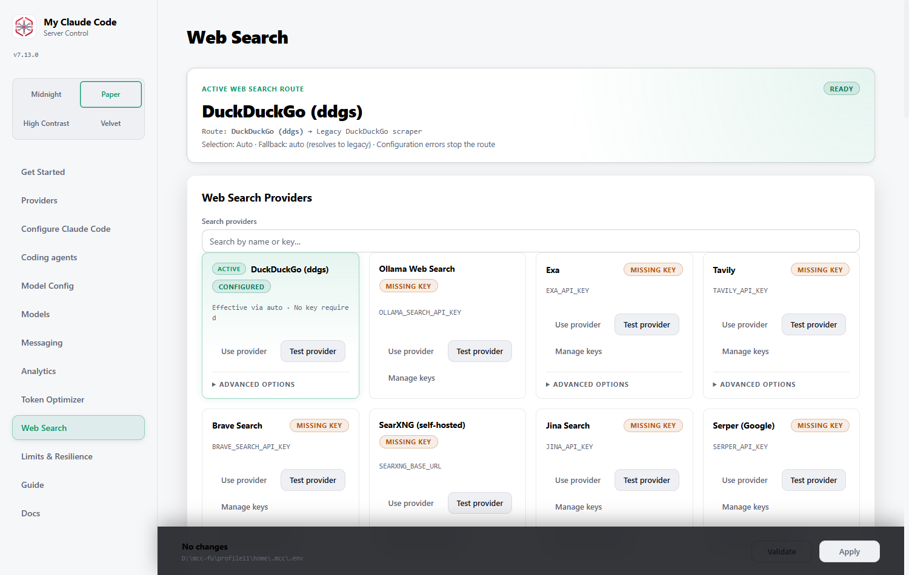
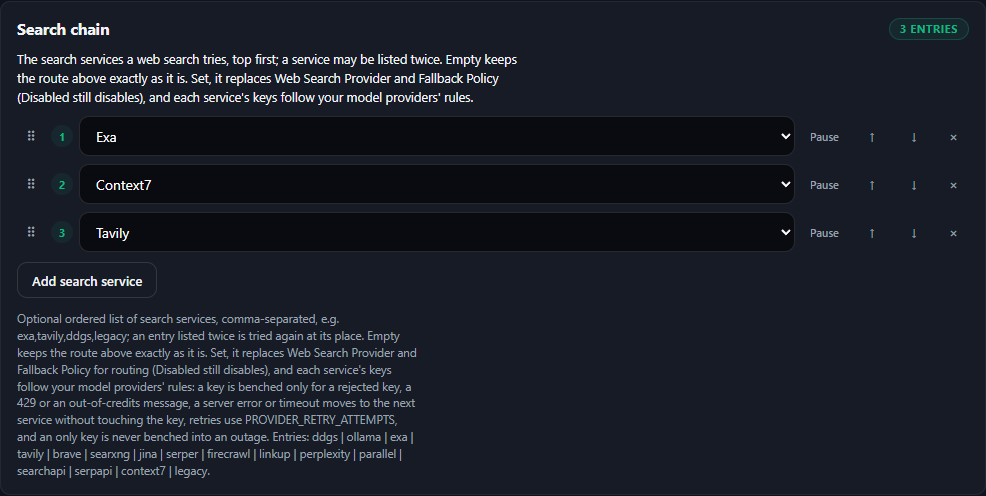
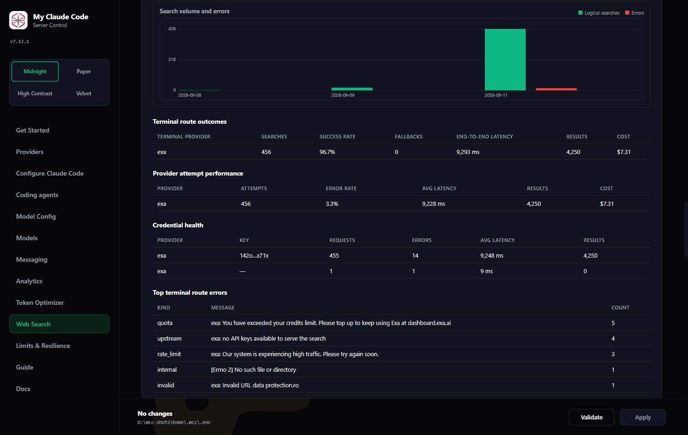

# Web search

Claude Code's official `web_search` server tool, fulfilled at the proxy by 15 search providers (Context7's library documentation since 7.113.0). Moved out of the README in 6.57.0.

Claude Code's `web_search` is an Anthropic **server tool**: normally Anthropic's servers execute the search and bill you for it. MCC fulfills that server tool at the proxy level instead — the client emits a `web_search` tool-use block, MCC runs the search against a provider you choose (or the keyless default), and streams the results back as a regular text block. No Anthropic search credits are used, and the whole flow works with any model provider.

<div align="center">
  
  <p><em>Web Search view: route summary, provider cards, key health, and its own analytics.</em></p>
</div>

### Search Providers

MCC supports 15 search backends, resolved by `WEB_SEARCH_PROVIDER`:

| Provider | Env var | Free tier | Get a key |
| --- | --- | --- | --- |
| DuckDuckGo (`ddgs`) | — (keyless) | Free, keyless (unofficial metasearch; engines may IP-rate-limit) | — |
| Ollama Web Search | `OLLAMA_SEARCH_API_KEY` | Free hosted tier with a free Ollama account | [ollama.com/settings/keys](https://ollama.com/settings/keys) |
| Exa | `EXA_API_KEY` | $20 signup credit + $10/month free ongoing | [dashboard.exa.ai/api-keys](https://dashboard.exa.ai/api-keys) |
| Tavily | `TAVILY_API_KEY` | 1,000 credits/month free, no card | [app.tavily.com/home](https://app.tavily.com/home) |
| Brave Search | `BRAVE_SEARCH_API_KEY` | $5 in free credits every month | [api-dashboard.search.brave.com](https://api-dashboard.search.brave.com/) |
| SearXNG | `SEARXNG_BASE_URL` | Free, self-hosted (AGPL); instance must enable `format=json` | self-hosted |
| Jina Search | `JINA_API_KEY` | 10M free tokens for new keys | [jina.ai/api-dashboard](https://jina.ai/api-dashboard/) |
| Serper (Google) | `SERPER_API_KEY` | 2,500 free one-time queries | [serper.dev/api-key](https://serper.dev/api-key) |
| Firecrawl | `FIRECRAWL_API_KEY` | One-time free credit grant on signup | [firecrawl.dev/app/api-keys](https://www.firecrawl.dev/app/api-keys) |
| Linkup | `LINKUP_API_KEY` | $20 free credit, topped back up monthly | [app.linkup.so](https://app.linkup.so/) |
| Perplexity Search | `PERPLEXITY_SEARCH_API_KEY` | No meaningful free tier (prepaid credit; mint a fresh key) | [perplexity.ai/settings/api](https://www.perplexity.ai/settings/api) |
| Parallel | `PARALLEL_API_KEY` | Pay-per-use from $0.005 per 10 results | [platform.parallel.ai](https://platform.parallel.ai/) |
| SearchAPI.io | `SEARCHAPI_API_KEY` | 100 free one-time requests | [searchapi.io](https://www.searchapi.io/) |
| SerpAPI | `SERPAPI_API_KEY` | 250 free searches/month | [serpapi.com/manage-api-key](https://serpapi.com/manage-api-key) |
| Context7 (library docs) | `CONTEXT7_API_KEY` | Free key from the dashboard; paid plans raise the limits | [context7.com/dashboard](https://context7.com/dashboard) |

`WEB_SEARCH_PROVIDER` accepts `auto` (default), `off`, `disabled`, or one of the provider IDs `ddgs | ollama | exa | tavily | brave | searxng | jina | serper | firecrawl | linkup | perplexity | parallel | searchapi | serpapi | context7`:

- **`auto`** picks the first configured provider in catalog order — never `context7`, which answers with library documentation rather than web pages; with no keys set it falls back to keyless `ddgs`, so search works **zero-config out of the box**.
- **`off`** preserves the legacy DuckDuckGo HTML scraper without using the provider registry.
- **`disabled`** rejects web searches without making an outbound search request.
- An explicit ID pins that provider and is strict by default: missing credentials or upstream failure are surfaced instead of silently changing providers.

`WEB_SEARCH_FALLBACK_POLICY` controls the route after the selected provider:

| Policy | Behavior |
| --- | --- |
| `auto` (default) | `WEB_SEARCH_PROVIDER=auto` uses selected → DDGS → legacy; a named provider is strict |
| `none` | Selected provider only |
| `ddgs` | Selected provider → DDGS |
| `legacy` | Selected provider → DDGS → legacy scraper |

Configuration failures such as a missing API key always fail visibly. DDGS is never attempted twice, and the rich digest identifies the provider that ultimately produced the results.

Minimal `.env` example (two keys with round-robin, see below):

```bash
WEB_SEARCH_PROVIDER=auto
WEB_SEARCH_FALLBACK_POLICY=auto
TAVILY_API_KEY="tvly-key1,tvly-key2"
TAVILY_API_KEY_ROTATION=round_robin
# Optional outbound proxy for web search (http/socks5):
WEBSEARCH_PROXY=""
```

You can also configure everything from **Admin UI → Web Search**. The route summary shows the complete configured chain and the last observed terminal route; the effective card is highlighted, providers can be selected directly, and each card exposes testing, key health, rotation, and advanced options. Deep per-provider pricing, my-tier details, and a capability matrix live in [research/web-search-providers.md](../research/web-search-providers.md) and [research/web-search-advanced.md](../research/web-search-advanced.md).

### Multi-key rotation (web search keys)

Comma-separate multiple keys in the same variable and pick a policy via `{ENV}_ROTATION`:

```bash
EXA_API_KEY="exa-key-a,exa-key-b,exa-key-c"
EXA_API_KEY_ROTATION=failover   # single | round_robin | least_used | failover (on_error)
```

The default is `failover` when multiple keys are set, `single` otherwise; `on_error` is accepted as another name for `failover` (since 7.112.0, as on model providers).

Web search keys run on the same rotation engine as model provider keys, but **which rules apply depends on whether a search chain is set**:

- **No `WEB_SEARCH_CHAIN` (the default):** each key is tried at most once per search, with no retry on the same key, and since 7.112.1 a key is charged by the same model rules as with a chain: only a rejected key (a 401 or 403: locked out for 5 minutes, doubling up to an hour), a 429 (benched for the wait the provider published, 60 s if it gave none) or an out-of-credits message (locked out like a rejected key; a bare 402 benches nothing) costs the key anything — a 5xx, a timeout, a refused connection or an unreadable body leaves it usable, and the search moves on to the next key or fallback as before. A provider with **one** key is never benched into an outage: the next search tries it again, except inside a 429's wait, which is answered "rate limited, retry after N s" without a call; a keyless provider (DuckDuckGo, SearXNG) is never benched at all. A failed search tells the client what happened (for example `web_search rate limited by exa: retry after 7s` or `web_search unavailable: exa answered with a server error (HTTP 503)`).
- **`WEB_SEARCH_CHAIN` set (7.112.0):** each service's keys follow the model provider rules — see [Model Providers → Multi-Key Rotation](#model-provider-key-rotation). A key is benched only for a rejected key (`CREDENTIAL_LOCKOUT_TIERS`), a 429 (`RATE_LIMIT_COOLDOWN_MODE/SECONDS/MAX_SECONDS`) or an out-of-credits message (a bare 402 benches nothing). A 5xx, a timeout or an unreadable body moves the search to the next service without touching the key; a refused connection tries the next key. Each key gets `PROVIDER_RETRY_ATTEMPTS` tries with `PROVIDER_RETRY_BACKOFF_*` backoff, and an only key is never benched into an outage. Every key try is recorded on the attempt row.

#### Search chain (`WEB_SEARCH_CHAIN`, 7.112.0)

```bash
WEB_SEARCH_CHAIN=exa,tavily,ddgs,legacy   # ordered; a service listed twice is tried again at its place
WEB_SEARCH_CHAIN_PAUSED=                  # entries to skip without removing them
```

Unset, nothing changes: `WEB_SEARCH_PROVIDER` and `WEB_SEARCH_FALLBACK_POLICY` route every search exactly as before. Set, the chain replaces both for routing (`WEB_SEARCH_PROVIDER=disabled` still disables search). Entries are the provider IDs above plus `legacy` (the old DuckDuckGo scraper). An entry whose key is not set is skipped and its attempt row names the variable; a paused entry is skipped; an entry whose every key is cooling down for at least `FALLBACK_COOLDOWN_STEP_OVER_FLOOR` is stepped over unless it is the last one. A 400 from one service moves on to the next (each builds its own request); a failure kind listed in `FALLBACK_SKIP_KINDS` ends the search; `FALLBACK_TOTAL_TIMEOUT` (0 = none) bounds the whole search. No proxy chains apply to search; `WEBSEARCH_PROXY` and the system proxy behave as before.

**On the dashboard (7.113.0).** **Admin → Web Search → Search chain** draws the chain with the same editor as a model fallback chain: **Add search service** adds a row with a picker of every service above plus the old scraper; the arrows and the grip reorder it (a drag says what it moved and offers **Undo**); a service you list twice shows a `×2` chip and is tried again at its place; **Pause** on a row pauses that service at every place it is listed (`WEB_SEARCH_CHAIN_PAUSED`); a row whose service has no key says *no key configured* — the search skips it. Nothing is written until **Apply**, through the same save as every other setting. With a chain set, the route summary at the top of the page shows the chain instead of the provider route and says plainly that Web Search Provider and Fallback Policy are not used while it is; each provider card says where it sits in the chain (`Search chain #1, #3`) or that it is not in it.

<div align="center">
  
  <p><em>The Search chain card: one row per service, in try order.</em></p>
</div>

**Key health on the page.** A provider card's **Manage keys** shows each key's health from the pool that serves today's route — the chain's books when the chain lists that service (the card says so), otherwise the provider's own pool — in the model rules' words: *benched 60 s: rate limited*, *benched 30 s: out of credits*, *locked out, tier 2 of 3 (1h left)*. A benched key has a **Reset** button that puts it back in service at once (nothing is saved; on the chain it is the model pool's own reset).

**In Analytics.** Once a chain has written rows, the Recent requests table gains **Position** (the entry's place in the chain), **Key tries** (expands to every try on every key — status, time, the wait slept, and what the pool decided: *benched 300s (auth) → next key*) and **Failure kind**; the **View** dialog shows the same tries under *Key tries*. A row written without a chain, or before 7.112.0, shows `—` in them — not measured, never 0.

### Context7: library documentation as a search service (7.113.0)

Context7 returns up-to-date **documentation and code examples for software libraries**, not web pages. Add `CONTEXT7_API_KEY` (keys start with `ctx7sk`; a comma list rotates like every other provider, with `CONTEXT7_API_KEY_ROTATION`), then either choose it by name (`WEB_SEARCH_PROVIDER=context7`) or — more useful — put it in the search chain where you want documentation answers, e.g. `WEB_SEARCH_CHAIN=context7,exa,tavily`. **`auto` never picks it**, so a key you set for it (or export for another tool) never turns every web search into a documentation lookup.

One search is two calls with `Authorization: Bearer <key>`: `GET https://context7.com/api/v2/libs/search` resolves the query to the best-matching library, then `GET /v2/context` returns that library's documentation for the query. Each snippet becomes one result: the title is the library and the section (*Next.js — Cache a fetch request*), the URL is the source Context7 cites, and the excerpt is the description followed by the code, cut at 1,000 characters with a visible `…[excerpt truncated]` marker (the digest's page-text cap, `WEBSEARCH_DIGEST_CONTENT_CHARS`, reads a longer form). No matching library is an empty answer, not an error. A rejected key, a 429 (with Context7's `Retry-After`), a 5xx or an unreadable answer are handled exactly as for every other provider, with or without a chain. Context7 has no advanced options and no domain filters.

The API was read from Context7's own clients (`@upstash/context7-mcp` and `@upstash/context7-sdk`); MCC's adapter has been proven against recorded responses of that shape, **not verified on a real key**.

### The keyless DuckDuckGo hop (7.119.0)

The last hop of the `auto` route — and the `legacy` entry of a search chain — asks DuckDuckGo's no-JavaScript pages. Since 7.119.1 it submits the **html** page's own search form first (`POST https://html.duckduckgo.com/html/` with `q` and `b`), with the headers a browser sends for that form — `Referer: https://html.duckduckgo.com/` and `Sec-Fetch-Dest`, `Sec-Fetch-Mode`, `Sec-Fetch-Site`, `Sec-Fetch-User` — and one static browser-class User-Agent (Firefox ESR on Windows). It asks the **lite** page (`GET https://lite.duckduckgo.com/lite/`) only as the second try, when the html page held no result and no bot check. Headers only: no TLS or HTTP/2 fingerprint is imitated, and MCC's own HTTP client keeps certificate verification at the library's default. (7.119.0 asked only the lite page, as `my-claude-code/<version>`; `web_fetch` keeps its own User-Agent.) Everything it knows about DuckDuckGo is declared as data in `config/duckduckgo_profiles.py`: both requests with their fields and headers, the User-Agent, and one row per page kind (html and lite) naming the result row, the title link, the snippet, the ad rows and the next-page form. A markup change is an edit to one row plus a recorded page, not a code change.

- **Results** carry the title, the destination (DuckDuckGo's `/l/?uddg=` redirect, decoded once) and, since 7.119.0, the **snippet**. Ad rows (`result--ad`) and `y.js` ad links are skipped. When no declared row matches, the link scan of earlier releases still runs, so a layout change never answers worse than before.
- **Region and time.** `DDGS_REGION` and `DDGS_TIMELIMIT` (the `ddgs` options) travel as the page's own `kl` and `df` fields when they are set — in the html form, and in the lite page's address when it is asked; unset, nothing extra is sent. Whether the live pages honour both has not been verified (no live call was made).
- **A bot check is reported, never worked around.** HTTP 202, or DuckDuckGo's own check markers (`anomaly-modal`, `anomaly.js`, `challenge-form`, *bots use DuckDuckGo*) on a page with no result, is a **rate limit** that says what was seen — `web_search rate limited by legacy: DuckDuckGo answered with its bot check instead of results (HTTP 202; …)`, code `too_many_requests` — never "no results". A bot check on the html page ends the search there: the lite page is not asked. In a search chain it moves on to the next entry exactly as a 429 from DuckDuckGo does; your `PROVIDER_RETRY_ATTEMPTS` and cooldown settings apply unchanged.
- **A page MCC cannot read** — one that carries DuckDuckGo's next-page form but no row any profile finds — lets the lite page try; if that has nothing either, the search is a failure (*answered with a results page MCC could not read*), not an empty answer.
- **Other failures**, with no chain set, are worded like every provider's: `web_search unavailable: legacy refused access (HTTP 403)`, `web_search rate limited by legacy: retry after 7s` (DuckDuckGo's `Retry-After`), `web_search unavailable: legacy answered with a server error (HTTP 503)`. An HTTP error or a connection failure on the html form ends the hop there, with no lite try. With a chain set the chain classifies them exactly as it did before 7.119.0. When neither page has a result nor any sign of a check, the answer stays an honest empty one (*No web search results found*).
- **Spacing.** `WEBSEARCH_LEGACY_MIN_INTERVAL_SECONDS` (**Legacy Scrape Minimum Interval (s)** on the Web Search page) is the least time between two of the hop's requests; the html request and the lite request that may follow it in the same search count as two. `0`, the default, sends them back to back, as before. For reference, octos waits about 3 s and Crush a random 0.5–2 s; the value is yours. Only this hop waits, and the next search uses a changed value.

```bash
WEBSEARCH_LEGACY_MIN_INTERVAL_SECONDS=0   # seconds between the hop's requests; 0 = back to back
DDGS_REGION=uk-en                         # also sent to the hop as kl
DDGS_TIMELIMIT=w                          # also sent to the hop as df
```

DuckDuckGo publishes no search API for this use, and every project that reads these pages documents its bot check; nothing can promise that the hop answers. What MCC promises is to say which of the two happened.

### Advanced options

Each provider exposes dotenv-only knobs (never in pydantic Settings); empty/unset values reproduce default behavior exactly. All of them are editable from the Web Search tab's **Advanced options** drawers. Highlights — cost warnings apply as noted:

| Provider | Notable options |
| --- | --- |
| Exa | `EXA_SEARCH_TYPE` (`deep*` = $0.015/query vs $0.005), `EXA_CONTENTS` modes incl. `full` (+$0.001/page per content type), `EXA_CATEGORY` verticals (company/people disable date+exclude filters), `EXA_MAX_AGE_HOURS`, published-date bounds, `EXA_USER_LOCATION` |
| Brave | `BRAVE_SEARCH_MODE=llm-context` ($5/1k, returns pre-extracted page text), `BRAVE_LLM_MAX_TOKENS` (1024–32768, llm-context only), `BRAVE_FRESHNESS`, country/language, plan-gated `BRAVE_EXTRA_SNIPPETS`, `BRAVE_SAFESEARCH` |
| Tavily | `TAVILY_SEARCH_DEPTH=advanced` (2 credits/query), `TAVILY_TOPIC`, `TAVILY_TIME_RANGE`, `TAVILY_INCLUDE_ANSWER` (basic/advanced LLM answer lead), `TAVILY_INCLUDE_RAW_CONTENT` (free full page text, may add latency), `TAVILY_CHUNKS_PER_SOURCE` (1–3, more text per result), `TAVILY_COUNTRY`, `TAVILY_START_DATE`/`TAVILY_END_DATE` |
| Serper | `SERPER_GL`/`SERPER_HL`/`SERPER_TBS`, `SERPER_RICH_BLOCKS` (default on: answerBox/knowledgeGraph/peopleAlsoAsk feed the answer lead) |
| Linkup | `LINKUP_DEPTH=deep` (10x cost, $0.05/query), `LINKUP_OUTPUT_TYPE=sourcedAnswer` (+$0.001, returns answer+sources), `LINKUP_FROM_DATE`/`LINKUP_TO_DATE` |
| Perplexity | `PERPLEXITY_SEARCH_RECENCY`, `PERPLEXITY_CONTEXT_SIZE` (omitted when `PERPLEXITY_MAX_TOKENS_PER_PAGE` is set) |
| Parallel | `PARALLEL_MODE` (turbo cheapest → advanced highest quality), `PARALLEL_EXCERPT_CHARS`, `PARALLEL_TOTAL_CHARS`, `PARALLEL_LOCATION` |
| Firecrawl | `FIRECRAWL_SOURCES` (web/news/images), `FIRECRAWL_SCRAPE_FORMAT` summary/markdown (multiplies credits per result), `FIRECRAWL_TBS`, `FIRECRAWL_LOCATION`, `FIRECRAWL_COUNTRY` (provider defaults to US), `FIRECRAWL_CATEGORIES` (github/research/pdf) |
| Jina | `JINA_MAX_TOKENS` (token-billed; best cost guardrail), `JINA_SITE`, `JINA_GL` |
| SearXNG | `SEARXNG_ENGINES`, `SEARXNG_CATEGORIES`, `SEARXNG_TIME_RANGE`, `SEARXNG_LANGUAGE`, `SEARXNG_SAFESEARCH` |
| ddgs | `DDGS_BACKEND` (pin one free engine to dodge per-engine rate limits), `DDGS_REGION`, `DDGS_TIMELIMIT`, `DDGS_SAFESEARCH` |
| SerpAPI | `SERPAPI_ENGINE` (`google_light` is cheaper, `num=100` works), `SERPAPI_TBS`, `SERPAPI_GL`, `SERPAPI_HL`, `SERPAPI_SAFE` |
| SearchAPI.io | `SEARCHAPI_ENGINE` (google/news/scholar/bing), `SEARCHAPI_TIME_PERIOD`, `SEARCHAPI_GL`, `SEARCHAPI_HL`, `SEARCHAPI_SAFE` |

Every option's drawer states what leaving it blank does, so an empty field always reproduces the provider's own default. See the **Web Search Advanced Options** block in [.env.example](../.env.example) for the full list with inline cost notes.

### Rich digest

Search results are rendered as a richer digest than a plain title/URL list: an optional provider **answer lead** (from Exa/Tavily/Linkup/Serper rich blocks, etc.), then numbered results with title, publication date (`page_age` where the provider exposes it), URL, and an excerpt capped per result:

```bash
WEBSEARCH_DIGEST_CHARS=600           # per-result snippet cap
WEBSEARCH_DIGEST_CONTENT_CHARS=4000  # per-result cap for extracted page text
WEBSEARCH_DIGEST_ANSWER=true         # include the provider answer lead
```

All three are settable on the **Web Search** page in the dashboard (Result Snippet Cap, Extracted Page Text Cap, Lead With The Provider Answer) and take effect on the next search — no restart.

### Giving the model full page text, not just snippets

By default most providers return a one- or two-sentence snippet per result. Several can return the **extracted text of the page itself**, which is usually the difference between the model guessing from a summary and actually reading the source.

Turn it on per provider, then give it room:

```bash
# Pick whichever provider you use — each has its own switch:
EXA_CONTENTS=text                    # or highlights+text, full
TAVILY_INCLUDE_RAW_CONTENT=markdown  # or text
FIRECRAWL_SCRAPE_FORMAT=markdown     # or summary
BRAVE_EXTRA_SNIPPETS=true            # plan-gated

WEBSEARCH_DIGEST_CONTENT_CHARS=4000  # how much of it reaches the model
```

Jina, Parallel and Linkup return extracted text by default and need no switch.

Extracted text has its **own, larger cap** (`WEBSEARCH_DIGEST_CONTENT_CHARS`) rather than sharing the snippet cap, so opting into content isn't silently trimmed back to snippet length. Raise it for more grounding, lower it to control input tokens, or set it to `0` to keep snippets only.

> **Cost:** content options bill more on most providers (Firecrawl multiplies credits per result; Exa charges per content type) and increase input tokens on every search. Check the option's drawer in the Admin UI — each states its cost.

### Restricting searches to specific sites

Claude Code declares `allowed_domains`, `blocked_domains`, and `max_uses` on its `web_search` tool definition. MCC reads them from the request and forwards them, so:

```json
{ "type": "web_search_20250305", "name": "web_search",
  "allowed_domains": ["docs.python.org", "peps.python.org"] }
```

restricts results **server-side** on Exa, Tavily, Firecrawl, Linkup, Perplexity and Parallel — you pay for relevant results rather than filtering afterwards. Providers without native support drop the filters and search normally; every recorded attempt shows `supports_domain_filters`, so the analytics detail view tells you which happened.

Anthropic rejects requests carrying both lists, so if both arrive the allow list wins rather than silently intersecting them.

### Safe search, locale and freshness

Safe search is available on the providers that document it:

```bash
BRAVE_SAFESEARCH=strict      # off | moderate | strict
SEARXNG_SAFESEARCH=2         # 0 | 1 | 2
SERPAPI_SAFE=active          # active | off
SEARCHAPI_SAFE=active        # active | blur | off
DDGS_SAFESEARCH=strict
```

Locale is per provider and worth setting if you are not in the US — **Firecrawl defaults to US results unless told otherwise**:

```bash
FIRECRAWL_COUNTRY=DE
TAVILY_COUNTRY=germany
BRAVE_COUNTRY=DE
SERPER_GL=de           # SERPAPI_GL / SEARCHAPI_GL / JINA_GL are the same idea
PARALLEL_LOCATION=DE
```

Freshness uses each provider's own vocabulary (`BRAVE_FRESHNESS=pw`, `TAVILY_TIME_RANGE=week`, `SERPER_TBS=qdr:w`, …). For a precise window rather than a relative one, several providers now take explicit dates:

```bash
TAVILY_START_DATE=2026-01-01
TAVILY_END_DATE=2026-06-30
LINKUP_FROM_DATE=2026-01-01
EXA_START_PUBLISHED_DATE=2026-01-01
```

Two more worth knowing:

- `TAVILY_CHUNKS_PER_SOURCE=3` — more snippets per source, the cheapest way to get more text out of Tavily without raw content.
- `FIRECRAWL_CATEGORIES=github,research` — restrict to GitHub or research papers, which is often exactly what a coding question wants.

### How failures are reported

Search failures come back to the client as a proper `web_search_tool_result_error` with the error code that matches what happened, so a client can react correctly rather than treating everything as a generic outage:

| What happened | Code the client sees |
| --- | --- |
| Rate limited or plan quota exhausted | `too_many_requests` |
| Request rejected by the provider | `invalid_tool_input` |
| `max_uses` budget leaves no room | `max_uses_exceeded` |
| Anything else | `unavailable` |

**Rate limits use the provider's own reset time.** When a provider returns 429 it usually says when the limit clears (`Retry-After`, `retry-after-ms`, `x-ratelimit-reset-*`); MCC honours that instead of assuming a fixed cooldown, so a key that resets in a second isn't benched for a minute and one that needs an hour isn't hammered. If the provider says nothing, a conservative default applies. Nothing is capped by an invented ceiling — the only bound is a 1-hour sanity limit on what a single header can request.

### Web search analytics

Every logical search and each provider attempt are recorded by a non-blocking background writer in `~/.mcc/logs/websearch.db`. Route records include a correlation ID, primary and terminal providers, the attempted chain, fallback use, final status, end-to-end latency, results, and known cost. Attempt records additionally retain the complete normalized tool input and provider output: full query and domain parameters, provider answer/rich summary, every result's title/URL/snippet/full content/publication date, result count and cost. A redacted snapshot preserves the effective provider, route/fallback policy, base URL, proxy endpoint without credentials, timeout, rotation policy, credential count, capabilities, and advanced options used for that attempt. Legacy scraper outcomes use the same detail shape.

<div align="center">
  
  <p><em>Web search analytics: the chart and the first table count logical searches; the tables below them count provider attempts, which is why the numbers differ.</em></p>
</div>

The Admin UI keeps the two levels explicit: top cards and the main trend chart report logical searches, route success/fallback rate, average attempts, and end-to-end latency, while provider/key tables and recent rows report individual attempts. Each recent row has an accessible **View** dialog with effective configuration, tool input, a readable answer/result summary, and the complete normalized output JSON (and, for a search chain row, its position, outcome, failure kind and per-key tries, as described under Search chain above). Filtering searches captured input/output as well as query previews, and JSON export includes the captured detail payloads. Existing pre-4.12 attempt history remains visible, but logical-route metrics begin with 4.12:

```bash
WEBSEARCH_LOG_ENABLED=true
WEBSEARCH_LOG_MAX_ROWS=500000   # retention cap; oldest rows pruned
WEBSEARCH_LOG_CAPTURE_CONTENT=true      # false keeps lengths + SHA-256 only
WEBSEARCH_LOG_CONTENT_MAX_CHARS=2000000 # cap per input/output JSON payload
```

Oversized payloads are stored as valid JSON truncation envelopes containing the original length, SHA-256, and a bounded preview. API keys are never copied into configuration snapshots, secret-looking object fields are redacted, and proxy/userinfo credentials are removed. Search content still commonly includes private queries, result URLs, and page text. `WEBSEARCH_LOG_CAPTURE_CONTENT=false` withholds the captured input/output payloads **and the query text itself**, keeping only lengths and SHA-256 hashes, so the switch covers everything a search reveals. Set `WEBSEARCH_LOG_ENABLED=false` to record nothing at all.

<a id="admin-dashboard"></a>

